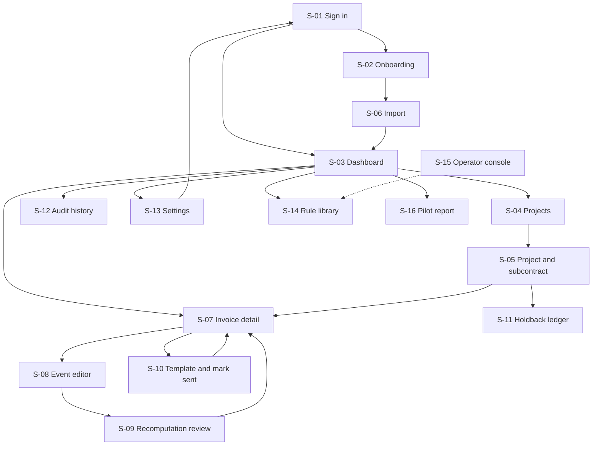

# App flow — PayClock

Labels and IDs: [Decision.md section 0](Decision.md#0-how-numbers-and-claims-are-labelled). Roles: [PRD.md section 6](PRD.md#6-buyer-users-and-roles). All screens are proposed; none is built.

## 1. Navigation

## 2. Screen inventory

Common acceptance checks for every screen: tenant from session only; a role outside "Roles" sees the permission-denied state; URL reload restores the same view.

| ID | Route | Roles | MH |
|---|---|---|---|
| S-01 | `/sign-in`, `/reset` | Anyone | MH-10 |
| S-02 | `/onboarding` | owner | MH-09, MH-10 |
| S-03 | `/app` | owner, member, viewer | MH-07 |
| S-04 | `/app/projects` | owner, member, viewer | MH-01 |
| S-05 | `/app/projects/{id}` | owner, member, viewer (read) | MH-01, MH-02, MH-03 |
| S-06 | `/app/import`, `/app/import/{batchId}` | owner, member | MH-01 |
| S-07 | `/app/invoices/{id}` | owner, member, viewer (read) | MH-04, MH-05, MH-09 |
| S-08 | `/app/invoices/{id}/events/{eventId}` | owner, member | MH-02, MH-06 |
| S-09 | `/app/recomputations/{id}` | owner, member, viewer | MH-06 |
| S-10 | `/app/invoices/{id}/actions/{actionId}` | owner, member | MH-08 |
| S-11 | `/app/projects/{id}/holdback` | owner, member, viewer (read) | MH-11 |
| S-12 | `/app/audit` | owner, viewer | MH-06 |
| S-13 | `/app/settings` | owner (team, billing, delete); member (own reminders) | MH-10, MH-12 |
| S-14 | `/app/rules` | all | MH-03, MH-09 |
| S-15 | `/ops/rules` | operator | MH-03 |
| S-16 | `/app/pilot-report` | owner, viewer | MH-12 |

### S-01 Sign in
- Story: as a user I sign in so that I reach my firm's workspace.
- Entry: none. Inputs: email, password, TOTP code if enabled.
- Visible: form, "Forgot password", help link.
- Actions and destinations: sign in to S-03, or S-02 if onboarding is incomplete; a deep link is honoured after sign-in.
- Checks: wrong credentials give one generic error and keep the email; five failures in 15 minutes lock for 15 minutes; password managers and paste work.

### S-02 Onboarding
- Story: as an owner I set up my firm and accept the terms so that I understand this is not legal advice.
- Entry: first sign-in. Inputs: firm legal name, trade, digest weekday, team invites, disclaimer acceptance, baseline for M-04 (notices sent in the last 30 days).
- Visible: three steps with progress; the disclaimer in full.
- Actions: save and continue to S-06; "do this later" on invites.
- Checks: cannot continue without acceptance; acceptance stored with version and time; leaving mid-way resumes at the same step.

### S-03 Dashboard
- Story: as a member I see what needs attention next so that no date passes unnoticed.
- Entry: signed in. Inputs: filters (project, state, clock family), search.
- Visible: rows of open invoices ordered by next act-by date; per row: contractor, amount, next clock, date, days left, state chip (`computed`, `provisional`, `not computable`), flag count; a "needs a fact" group for invoices with missing triggers; failed reminders.
- Actions: open S-07; add invoice; import (S-06).
- Checks: order equals next act-by ascending with `not computable` invoices in their own group, never at the bottom unseen; filters live in the query string.

### S-04 Projects
- Story: as a member I list projects so that I can keep facts per project.
- Visible: project, contractor, owner if known, rule version or "applicability unknown", open invoices, holdback balance.
- Actions: create project; open S-05.
- Checks: empty state offers "add project" and "import".

### S-05 Project and subcontract
- Story: as a member I record the facts that decide which rules apply.
- Inputs: contractor, owner, prime contract date (EV-11), procurement start (EV-12), whether the premises are leased and since when, whether a municipality has an interest, whether the user has sub-subs, last supply (EV-07), publication of substantial performance (EV-08) and the date it certifies (EV-19), contract completed or abandoned (EV-09), contract terminated (EV-17, the actual date) and, as a separate field, Form 8 published (EV-18), subcontract certification (EV-10). Each date has "confirmed / estimated / unknown" and optional evidence. There is no subcontract-date field: it selects no rule.
- Visible: resulting rule version with the section that decides it; flags L-06, L-07.
- Actions: save (recompute, go to S-09 if any deadline changed); open S-11; open an invoice.
- Checks: "unknown" saves; changing EV-11 across 2019-10-01 switches the version and shows the diff; the termination date and the Form 8 publication date cannot be entered in one field, and entering only the publication date gives no exact adjudication date: the clock reads "no later than" publication plus 90 days (or an earlier known trigger), `provisional`, with "missing: actual termination date, which can only make this earlier" and flag L-11.

### S-06 Import
- Story: as a member I import my aging list so that I do not retype it.
- Inputs: CSV file; column mapping (invoice number, contractor, project, date given, amount, holdback).
- Visible: mapping preview of 10 rows; after submit, per-row results with counts created, duplicate, rejected.
- Actions: fix mapping; download rejected rows; retry rejected rows only; continue to S-03.
- Checks: totals reconcile to the file; re-upload creates nothing new; a batch URL shows the same results later.

### S-07 Invoice detail
- Story: as a member I see every clock on one invoice, what starts it and what is missing.
- Visible: header (amount, holdback, contractor, rule version); the governing due date CLK-17 first, with its path in words ("owner has not paid: 35 days from the contractor's invoice to the owner", "suspended by a notice of non-payment given in time", "disputed by notice"); a timeline of clocks grouped as Payment, Notices to watch, Your rights, Holdback; lien dates as two cards when work continued after substantial performance; "no later than" before any provisional rights date; per clock: date, act-by, trigger event with certainty and evidence link, section reference, state, flags; events list; actions list with stale marks.
- Actions: add or correct an event (S-08); generate a template (S-10); record a payment; open history.
- Checks: with EV-01 and EV-04 unknown, CLK-17 reads "not computable" with a "Request the date" action, while CLK-09 and CLK-11 still show dates; an invoice under a timely Form 1.2 or 1.3 is never shown as overdue; no clock is shown without its trigger.

### S-08 Event editor
- Story: as a member I add or correct a fact, with my reason, so that the record shows why dates moved.
- Inputs: date or "unknown", certainty, evidence upload, reason (required for corrections).
- Visible: current value, its history, the clocks that depend on it.
- Actions: save to S-09; cancel to S-07.
- Checks: a second editor saving first causes a conflict message showing the newer value; nothing is overwritten silently.

### S-09 Recomputation review
- Story: as a member I see exactly which dates changed.
- Visible: cause (event, old and new value, reason, user, time); table of deadlines with old date, new date, direction (earlier or later), rule version; cancelled and new reminders; actions now stale; flags raised.
- Actions: acknowledge and return to S-07; open any stale action.
- Checks: on arrival focus is on the page heading, which states the cause and the count of changed dates; a rights clock that moved earlier is listed first and announced; each row says "was" and "now" in text; the page is a permanent link.

### S-10 Template and mark sent
- Story: as a member I prepare a document and record that I sent it.
- Inputs: template choice; after sending outside PayClock: send date, method, copy upload.
- Visible: rendered text with merged facts, each statutory date with its trigger and certainty; draft watermark until marked sent; lawyer-review note (L-03, L-04).
- Actions: copy text; download PDF; mark sent; discard draft.
- Checks: six templates are listed (MH-08); a template asserting a statutory date is unavailable while its trigger is estimated or unknown, with the reason shown; PayClock offers no "send to contractor" control.

### S-11 Holdback ledger
- Story: as a member I see holdback retained and when release is expected.
- Visible: per subcontract: retained by invoice, released, balance; CLK-13 and CLK-14 with triggers; L-07 where the contract predates 2026-01-01.
- Actions: record Form 6 publication (EV-13), contractor's receipt if known (EV-14), release received.
- Checks: balance equals retained minus released to the cent.

### S-12 Audit history
- Story: as an owner I can show who changed what and when.
- Visible: filterable list of audit events; link to each recomputation.
- Checks: no edit or delete controls; export to CSV.

### S-13 Settings
- Story: as an owner I manage team, reminders, billing, export and deletion.
- Actions: invite, change role, remove; reminder preferences; plan and billing (start checkout, see the pilot credit, invoices, payment status; MH-13); list of weekly emails sent; export; delete workspace; grant or revoke PayClock staff access (`read` or `assisted_load`, with expiry and a list of what staff changed); sign out.
- Checks: deletion requires typing the firm name and shows what is removed and when; sign-out ends the session server-side and Back does not show data.

### S-14 Rule library
- Story: as any user I read the rule behind a date.
- Visible: clocks by rule version: trigger, count, section, effective dates, sign-off date and reviewer; what is not computed and why.
- Checks: every clock on S-07 links to its row here.

### S-15 Operator console
- Story: as an operator I draft and approve a rule version.
- Inputs: rule rows, effective dates, legal source, memo file hash, reviewer name.
- Actions: draft; preview impact (count of deadlines that would change); approve.
- Checks: approval impossible without memo hash; approved versions are read-only; no tenant data visible.

### S-16 Pilot report
- Story: as an owner I see what the pilot produced.
- Visible: invoices by state and by missing fact; dated actions with evidence; M-04; export.
- Checks: every count links to its rows.

## 3. States

| State | Where | Behaviour |
|---|---|---|
| Empty | S-03, S-04, S-11, S-12 | One sentence and the next action; S-03 offers import and "add one invoice" |
| Loading | All lists | Skeleton rows; no layout shift |
| Processing | S-06 import; S-13 export | Progress with counts; safe to leave; result at the same URL |
| Partial success | S-06 | "31 created, 4 duplicates, 5 rejected"; rejected rows downloadable and retryable |
| Validation error | Forms | Summary at top with links to fields; focus moves to the summary; entered values kept |
| Permission denied | Any | Explains the role needed; link back to S-03; other tenants' identifiers show "not found" |
| Timeout | Save, upload | "We could not confirm this was saved" plus "Check status", which reads the server by idempotency key; never a blind resubmit. The message is announced as an alert and focus moves to "Check status" |
| Retry | Reminders, import | Automatic per [TRD.md 8.4](TRD.md#84-jobs-retries-timeouts-idempotency); failures surface on S-03 |
| Conflict | S-08 | Shows the newer saved value and asks the user to re-apply; announced as an alert, focus moves to the message, the user's own entry stays in the form |
| Stale | S-07, S-10 | Stale actions and superseded dates carry the visible word "Superseded" or "Stale" with an icon, the same word in the accessible name, and a link to S-09; strikethrough is decoration only |
| Billing | S-03, S-13 | Past due: banner with days of grace left. Read-only: editing disabled, every existing date still shown, rights-clock reminders continue 30 days |
| Staff access | All | While an `assisted_load` grant is live a banner names it and its expiry; facts entered by staff show "entered by PayClock, not yet confirmed by you" |

## 4. Browser behaviour

- Refresh: every screen is rebuilt from the server; unsaved form text is kept in session storage for S-05, S-08, S-10 and cleared on save.
- Back and Forward: filters, tabs and pagination live in the URL; after a save, Back returns to the saved record, not a resubmitting form.
- Deep links: every record, batch, recomputation and action has a stable URL; links in emails go through sign-in and land on the target.
- Duplicate submission: buttons disable on submit; the server deduplicates by `Idempotency-Key`; a duplicate invoice (same subcontract and number) is reported, not created.
- Batch actions: import only. No bulk correction and no bulk mark-sent in the MVP.
- Reopening unfinished work: onboarding resumes at its step; import batches and draft actions are listed on S-03 under "Unfinished".

## 5. Irreversible and external actions

| Action | What the user reviews first |
|---|---|
| Mark an action sent (S-10) | The exact text, the dates and their triggers with certainty, the lawyer note; then enters send date and attaches the copy. Can be annotated later, not deleted |
| Correct an event (S-08) | Dependent clocks listed before saving; diff after (S-09) |
| Delete workspace (S-13) | Inventory of what is deleted, the 30-day backup expiry, export offered first |
| Approve a rule version (S-15) | Impact preview and memo hash |
| Sending anything to a contractor, owner, court or registry | Not possible in PayClock; the user does it outside |

## 6. Sign-out

From S-13 or the header menu: session invalidated server-side, client storage cleared, return to S-01. Sessions end after 12 hours of inactivity with a warning two minutes before and an option to continue.
