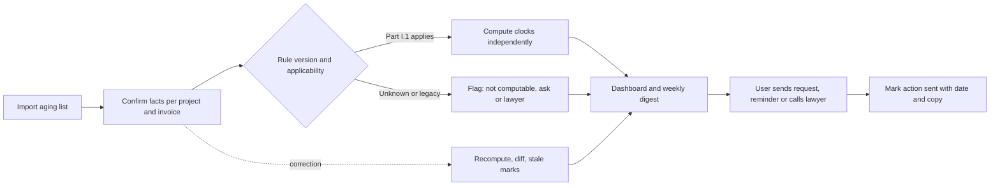

# PRD — PayClock

Labels and IDs: [Decision.md section 0](Decision.md#0-how-numbers-and-claims-are-labelled). Clocks `CLK-nn`, events `EV-nn` and rule versions: [Decision.md section 4](Decision.md#4-what-starts-each-clock-ontario-from-the-primary-source). All targets are proposed `[P]`.

## 1. Overview

PayClock gives an Ontario subcontractor a dated schedule for each open invoice: when the contractor's payment duty falls due under the Construction Act, when interest starts, the last days for adjudication and lien steps, and expected holdback release. It states which fact starts each date, which facts are missing, and where a lawyer is required. It produces dates and templates, not legal advice. This PRD describes the application; the CAD 99 hand-run pilot of Phase 0 is delivered without it ([Decision.md section 1](Decision.md#1-proposed-decision)), and "P0" below means required for the application pilot of Phase 6.

The repository exists to answer one question: which payment event, exception or notice remains underserved by PaySub and Tiercord ([Decision.md section 3](Decision.md#3-competitor-gap-the-decisive-question)). The working hypothesis is the payee who cannot see the upstream event (EV-01 unknown).

## 2. What the product does

1. Takes projects, subcontracts and invoices by form or CSV aging import.
2. Records dated events with a certainty of confirmed, estimated or unknown.
3. Decides which rule version governs and computes every clock independently.
4. Shows a dashboard sorted by next deadline; sends email reminders and a weekly digest.
5. On a corrected event, recomputes all dependent dates and keeps the trail.
6. Produces fixed-wording templates the user reviews and sends personally.
7. Flags every point reserved for a lawyer (L-01 to L-11).
8. Lets PayClock staff load a customer's records under an audited, time-limited grant, and converts a pilot into a subscription.

## 3. Why now

The 2026-01-01 amendments changed adjudication expiry, holdback release and deemed proper invoices `[S: SRC-01]`. Two competitors launched on the same law `[S: SRC-05]`, `[S: SRC-06]`; the window for a narrower product is defined by what they leave out, which Phase 0 tests.

## 4. Goals

| Goal | Measure |
|---|---|
| G-1 Answer the decisive question | Metric M-01 |
| G-2 Prove willingness to pay | M-02, M-03 |
| G-3 Never show a wrong or stale date as current | M-06, M-07 |
| G-4 Never force invented data | M-08 |

## 5. Problem statement

A subcontractor's statutory due date runs from events at the tier above (EV-01, EV-04) and its rights expire from events it may not notice (EV-08, EV-09). The office manager tracks invoice age instead, which starts no statutory clock. Existing tools either count from the subcontractor's own submission or expect the user to already hold the upstream facts.

## 6. Buyer, users and roles

Buyer and budget owner: the firm's owner `[C]`.

| Role | Person | May do |
|---|---|---|
| `owner` | Firm owner | Everything in the workspace; billing; delete workspace |
| `member` | Office manager, controller | Enter and correct data, generate templates, mark actions sent |
| `viewer` | The firm's lawyer or bookkeeper | Read, export; no edits |
| `operator` | PayClock staff | Draft rule versions (a second operator approves); no tenant data except under a grant from the `owner`: `read` (up to 72 hours) or `assisted_load` (up to 35 days: create and correct work records and events, never mark an action sent, never confirm a fact) |

## 7. Workflows

**Current** `[C]`: aging spreadsheet; calendar reminders; calls to the contractor's payables clerk; a lawyer at 60-90 days.

**Proposed**:

## 8. Must-haves

Priority P0 is required for the first application pilot (Phase 6); P1 before general sale.

| ID | Pri | User story | Observable acceptance criteria | Owner role |
|---|---|---|---|---|
| MH-01 | P0 | As a member I load projects, subcontracts and open invoices by form or CSV so that nothing is retyped | The project form collects the regime-selecting facts (EV-11, EV-12, leased premises, municipal owner), not a subcontract date; a 40-row CSV yields a per-row result (created, duplicate, rejected with reason); re-uploading the same file creates no second invoice; totals shown equal the file | Product |
| MH-02 | P0 | As a member I record each event as confirmed, estimated or unknown so that I never invent a date | Every event field accepts "unknown"; save succeeds; estimated and unknown are visibly marked wherever a dependent date appears | Product |
| MH-03 | P0 | As a member I see which rule version governs each clock so that old contracts are not dated under new rules | Given EV-11 and EV-12, the version is `ON-LEGACY`, `ON-NOPP`, `ON-2019-10` or `ON-2026-01` exactly as [Decision.md 4.4](Decision.md#44-rule-versions-and-transition), including leased premises and municipal interest (L-06); unknown EV-11 or EV-12 yields "applicability unknown", never a default; every deadline stores its rule version and lawyer sign-off reference | Rules lead |
| MH-04 | P0 | As a member I get the payment clocks for each invoice so that I know when it is overdue under the Act | CLK-03 to CLK-06 match the fixtures in `UT-01` to `UT-09` to the day; the governing due date CLK-17, overdue status and CLK-16 follow paths A to H of [Decision.md 4.2.1](Decision.md#421-which-clock-is-due-clk-17-overdue-and-interest) exactly (`UT-17` to `UT-19`): a late owner payment does not restart 7 days, a notice given in time suspends due date and interest, a late notice raises L-05; with EV-01 and EV-04 unknown the invoice shows "not computable: contractor's invoice date to owner", and the lien and adjudication clocks on the same invoice still compute | Rules lead |
| MH-05 | P0 | As a member I get the last days for lien and adjudication steps so that I call my lawyer in time | CLK-09 is computed as two variants (a, b) per [Decision.md 4.2.2](Decision.md#422-lien-preservation-clk-09-two-liens-and-termination); CLK-11 uses the actual termination date EV-17; the Form 8 publication EV-18 is never its trigger and, when EV-17 is unknown, yields only a "no later than" ceiling (`UT-15`); a late or unknown Form 8 raises L-11; with EV-08 unknown every lien date reads "no later than" and is `provisional` (`UT-16`); rights clocks show the un-extended last day, an act-by date, the L-09 note, the triggers still unknown and flag L-04; state is `computed`, `provisional` or `not_computable`, never "OK" | Rules lead |
| MH-06 | P0 | As a member I correct an event and see every date that changed so that nothing stale remains | A correction requires a reason; one recomputation record lists old and new date per deadline; superseded reminders are cancelled; templates built on a superseded date show "stale"; a sent action on a superseded date raises L-10; the prior values remain readable in history | Engineering |
| MH-07 | P0 | As a member I see invoices ordered by next deadline and receive reminders so that I act before a date passes | Dashboard order equals next act-by date ascending; reminders for rights clocks at 14, 7, 3 and 0 days before act-by and again at 5, 2 and 0 days before the last day; for a `provisional` rights clock every reminder says "no later than, may be earlier" and none presents the day as final; for payment clocks on the CLK-17 date and 3 days after; weekly digest on the chosen weekday, each send recorded; emails carry clock name, date, certainty and a link, and never an amount or a contractor or owner name | Product |
| MH-08 | P0 | As a member I generate a template and send it myself so that PayClock never contacts my general contractor | Six templates (reminder, EV-01 date request, s. 39(1) request, s. 39(4) publication request, interest statement, lawyer handoff pack); merge fields only, no generated wording; a template that asserts a statutory date is blocked while its trigger is estimated or unknown or its clock is not `computed`; the interest statement is blocked until L-09 is answered for the rate; PayClock sends email only to workspace users | Product |
| MH-09 | P0 | As an owner I see where a lawyer is required so that I do not mistake a date for advice | Each L-01 to L-11 condition raises a named flag on the record; a flag never marks a clock as passed and never stops other clocks computing; the disclaimer is accepted at onboarding and printed on every export | Rules lead |
| MH-10 | P0 | As an owner I control who sees my firm's data | Password sign-in with optional TOTP; roles as section 6; an `operator` can write tenant records only under a live `assisted_load` grant, every such write is audited and shown to the owner, and facts entered by an operator stay `estimated` until a tenant user confirms them (`IT-02`); a user of tenant A receives 404 for any tenant B identifier through UI, API, export and file link | Engineering |
| MH-11 | P1 | As a member I track holdback per subcontract with expected release | Ledger shows retained, released and balance; CLK-13 and CLK-14 compute when EV-11, EV-13 or EV-14 are known; contracts before 2026-01-01 show flag L-07 instead of a date | Rules lead |
| MH-12 | P0 | As an owner I get a pilot report and can export or delete my data | The workspace records pilot start and end dates; report shows the count of invoices by missing fact, dated actions with evidence, and M-04; export is a ZIP of CSV plus documents; deletion completes within 30 days including backups expiry | Product |
| MH-13 | P1 | As an owner I convert my pilot into a subscription and see what I am charged | Hosted checkout creates a subscription at the launch plan (`plan = launch`, CAD 99 per month) starting on day 31; the CAD 99 pilot fee appears as a credit and is consumed by the first invoices; payment-provider webhooks are verified, deduplicated by event id and applied by fetching current state, so a duplicate or out-of-order event changes nothing (`IT-15`); over the plan's open-invoice limit new invoices cannot be added; after a failed payment there are 7 days of grace, then the workspace is read-only; existing deadlines stay visible and rights-clock reminders continue for 30 more days in every billing state | Engineering |

## 9. Highest-cost user mistake

**Late or stale expiry date**: a lien or adjudication last day shown later than the statute allows, or still shown after the event behind it was corrected, so the subcontractor lets an irreversible right lapse.

- How it happens: the user enters the last day of supply as the day of a later warranty visit; stays on site after a certificate of substantial performance was published without knowing it (the lien for earlier work is already running, s. 31(3)(a), (4)); counts adjudication time from the published notice of termination instead of the termination itself; treats an estimated or "no later than" date as final; or reads a date computed before a correction.
- Who reviews: the `member` confirms each trigger with its evidence; the `owner` receives every recomputation that moves a rights clock earlier; the firm's lawyer reviews before any lien or adjudication step (L-04).
- How it is corrected: correct the event (MH-06); the engine recomputes, alerts the `owner` immediately if the new act-by date is within 14 days or past, and marks dependent templates stale. A lapsed right cannot be restored by the product.

## 10. Non-goals

Legal advice; preparing or registering a claim for lien, certificate of action, or notice of adjudication; sending anything to third parties; deciding whether a received notice is valid; the payer side (Forms 1.1 to 1.5 as sender; the user's own duty to sub-subs is shown as a date with flag L-08 only); Alberta, BC, federal projects; `ON-LEGACY` dates; QuickBooks or Xero sync; SMS; forwarded-email intake; generated wording; payments.

## 11. Dependencies and constraints

| Item | Kind | Note |
|---|---|---|
| Ontario construction lawyer | Dependency | L-01 to L-03 before any customer sees a date |
| Buyer's aging list and facts | Dependency | [Decision.md 5.2](Decision.md#52-what-the-buyer-must-provide) |
| Statute changes | Constraint | New rule version, effective-dated; never edit a signed version |
| PIPEDA; records and files stored in Canada | Constraint `[C]` | `AD-09`. Two processors are outside Canada: the email provider (message metadata and the limited content in MH-07) and the payment provider (billing contact only); listed in [TRD.md 8.10](TRD.md#810-subprocessors-and-data-location) |
| Legal questions LQ-01 to LQ-03 | Dependency | Gate the first message, first report and first paid pilot ([Decision.md section 6](Decision.md#6-dates-and-templates-not-legal-advice-what-that-rests-on)) |
| Not legal advice | Constraint `[C]` | MH-09 |
| Team of 1-3; 110 hours estimated `[C]` | Constraint | The estimate predates this scope; see [execution-plan.md section 5](execution-plan.md#5-estimate-summary) |

## 12. Success metrics

| ID | Type | Metric | Method and source | Denominator | Window | Baseline | Target `[P]` |
|---|---|---|---|---|---|---|---|
| M-01 | Decisive | Share of firms with at least one open invoice where EV-01 or applicability is unknown | Tally sheet per free report (`T-0.2.3`); later `flag` table | Firms given a report | Phase 0 | Unknown | 8 of 20 (gate G1b) |
| M-10 | Decisive | Share of firms that say they would not send their contractor a dated reminder or date request | Discovery-call answer (`T-0.2.2`) | Firms given a report | Phase 0 | Unknown | Under 12 of 20 (gate G1c) |
| M-02 | Commercial | Reports converting to paid pilot | Pilot payments received | Reports delivered | 21 days after each report | None | 3 of 20 (G1) |
| M-03 | Commercial | Pilots converting to paying account | First recurring invoice issued and settled | Paid pilots arising from the first 20 reports | Day 31-45 of each pilot; all known by day 124 | None | At least n / 3 rounded up (G2); 60% `[A]` |
| M-04 | Workflow | Dated-action rate ([Decision.md 5.3](Decision.md#53-pilot-metric-computable)) | `action` rows with sent date and copy, or payments after an alert | Paid pilots | 30 days | Self-reported prior 30 days | 60% |
| M-05 | Workflow | Share of invoices fully dated (all applicable clocks `computed`) | `deadline.state` | Open invoices | Weekly | Phase 0 tally | Report only |
| M-06 | Failure | Deadlines differing from the lawyer-checked hand calculation | Golden fixtures `UT-12`; monthly sample of 20 | Deadlines checked | Each release; monthly | 0 by construction | 0 |
| M-07 | Failure | Superseded dates still shown or reminded | `IT-07`, `IT-08`; production query for unsuperseded duplicates | Recomputations | Daily | n/a | 0 |
| M-08 | Failure | Saves blocked for lack of a date | Validation error log by field | Save attempts | Weekly | n/a | 0 for event dates |
| M-09 | Commercial | Monthly churn | Cancelled / active at month start | Paying accounts | Monthly | 3.5% `[C]` assumption | At or under 3.5% |

## 13. Evidence that would justify expanding the MVP

- QuickBooks sync: 3 or more paying accounts ask and CSV import takes them over 15 minutes a month.
- Payer side (Forms 1.4, 1.5): 3 or more accounts with sub-subs ask for it and the lawyer agrees to template it.
- Alberta: Ontario passes G2 and 10 Alberta firms accept a free report.
- SMS: reminders opened by under half of pilots.
- AI extraction: median manual entry time per invoice over 2 minutes in pilots.
