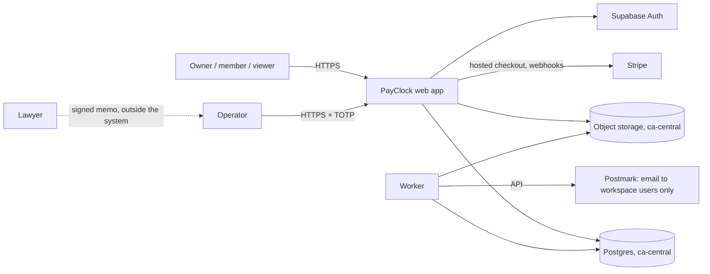
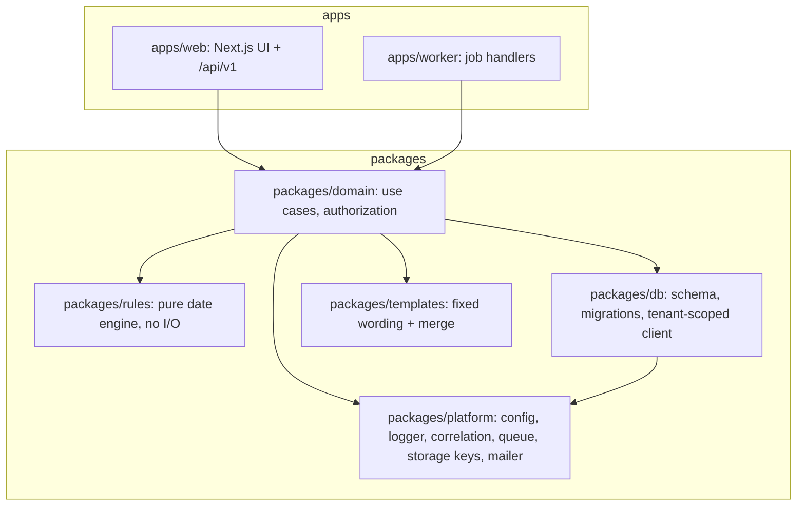
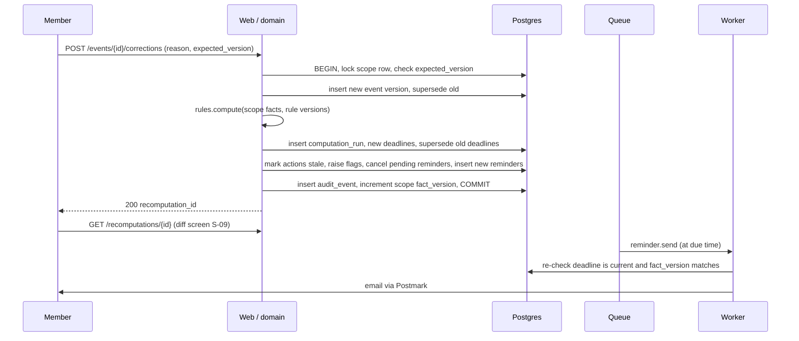
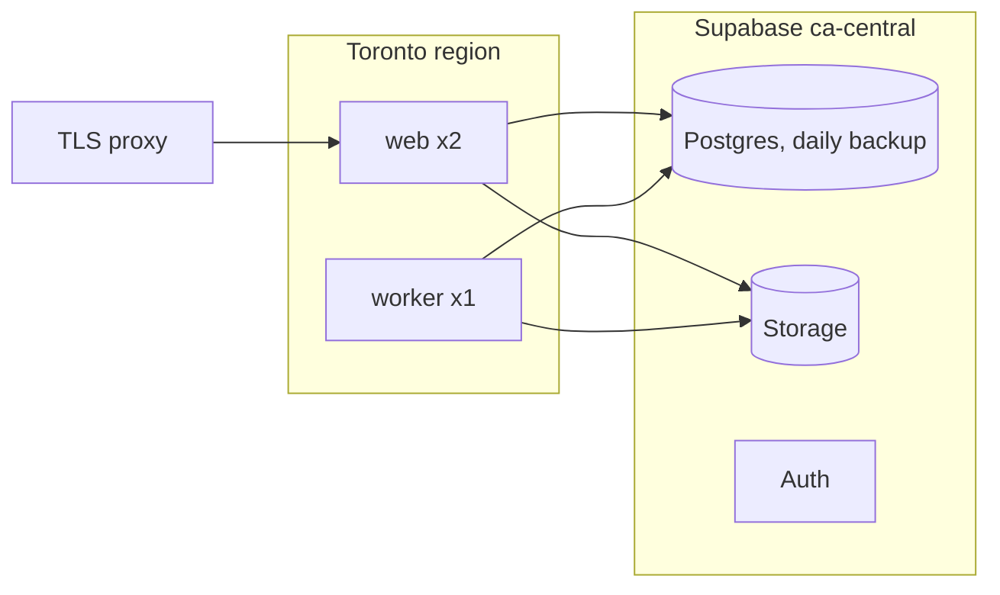

# TRD — PayClock (arc42 order)

Labels and IDs: [Decision.md section 0](Decision.md#0-how-numbers-and-claims-are-labelled). Every stack choice, command and target here is proposed `[P]`; nothing is implemented. The brief's stack suggestion `[C]` (Next.js, Supabase ca-central, Vercel, magic link, Postmark, Twilio, a small model for extraction) is a suggestion, not a decision; departures are recorded in section 9.

## 1. Introduction and goals

Requirements: [PRD.md](PRD.md). Top quality goals, in order: (1) date correctness and currency (no late or stale expiry date); (2) tenant isolation; (3) traceability of every date to rule version, facts and sign-off; (4) low operating cost for one founder.

## 2. Constraints

Team of 1-3 `[C]`; Canadian data residency and PIPEDA `[C]`; statutory dates, interest, access and applicability are deterministic code; a rule version is immutable once signed (L-01); no outbound message to third parties; planning repository holds Markdown only.

## 3. Context and scope



| External system | Direction | Data | Failure behaviour |
|---|---|---|---|
| Supabase Auth | in | Credentials, sessions | Sign-in unavailable; no data path affected |
| Postmark (outside Canada) | out | Reminder and digest emails to workspace users: clock name, date, certainty, link. No amounts, no contractor or owner names, no invoice numbers | Retry, then reconcile (section 8.4) |
| Stripe (outside Canada) | both | Billing contact, plan, subscription status; card data stays with Stripe; no invoice or project data | Webhook retry and state fetch (`AD-13`); 7 days of grace |
| e-Laws | none at runtime | Rule text is copied into rule versions by the operator | n/a |

Out of scope at runtime: QuickBooks, Xero, Twilio, inbound email, any model provider (section 8.8).

## 4. Solution strategy

A modular monolith with one pure rules package. Facts are append-only events; deadlines are a deterministic function of (rule version, facts) and are recomputed, never edited. User corrections recompute inside the same database transaction, so no reader can see a new fact with an old date.

## 5. Building blocks



Rules: apps import only package entry points; `packages/rules` imports nothing but its own files; only `packages/db` talks to Postgres; `packages/platform` has no React or Next imports (R-04, R-06, R-07).

### 5.1 Rules engine

- Input: rule version rows (`rule_clock`), a set of current events for one scope, a holiday calendar, an interest-rate table. Output: one result per applicable clock: `state` (`computed`, `provisional`, `not_computable`, `not_applicable`), `statutory_date`, `act_by_date`, `missing_facts[]`, `flags[]`, `rule_clock_id`, `inputs_hash`.
- Date type: civil date in America/Toronto. No timestamps, no time zones, no floating point (`AD-11`).
- `addDays(trigger, n)`: trigger day excluded; result extended past holidays (Sunday and the Legislation Act s. 88(2)-(5) days; not Saturday, not Civic Holiday) when the clock's `extend_on_holiday` is true. The engine receives the holiday rows and the years they cover (`holiday_coverage`); a count or extension reaching an uncovered year returns `not_computable` with missing fact `holiday_table:YYYY`.
- Version selection ([Decision.md 4.4](Decision.md#44-rule-versions-and-transition)): by each clock's governing date; unknown EV-11 or EV-12 gives `not_computable` with flag L-06, never a default; an estimated EV-11 or EV-12 within 365 days of a transition date likewise; any other estimated selecting fact adds `REGIME_ESTIMATED` and its event ids to every result. Every result carries L-01 while any rule version used is unsigned.
- Independence: each base clock (CLK-01 to CLK-16) is evaluated on its own inputs. A missing fact or a flag on one clock cannot suppress or pass another.
- Composition: CLK-17 (governing due date), overdue and CLK-16 are derived afterwards from CLK-03, CLK-04, CLK-05 and EV-05 by the fixed path table A to H in [Decision.md 4.2.1](Decision.md#421-which-clock-is-due-clk-17-overdue-and-interest), per amount. The derivation is the only place where one clock affects another.
- Event types are never substituted: CLK-11 reads EV-17 and cannot read EV-18; CLK-09's termination input is EV-18 only when it is within 7 days after EV-17, otherwise EV-17 with L-11. Ceiling rule: when EV-17 is unknown and EV-18 is known, EV-18 enters only as an upper limit on EV-17, so the result is the earliest of (EV-18 + count) and the other known triggers, always `bound = no_later_than`, state `provisional`, missing fact EV-17, never `exact` ([Decision.md 4.2.2](Decision.md#422-lien-preservation-clk-09-two-liens-and-termination)). The trigger specification names event types explicitly; there is no generic "termination" input.
- Open legal questions: a rule row may carry `pending_question` (for example L-09). The engine then withholds the dependent output (the extended day for rights clocks, any interest amount) and returns the flag instead. Rights clocks return the un-extended day as `statutory_date`, and `bound` = `exact` or `no_later_than`.
- Interest: simple interest, amount x rate x days / 365 in integer cents with half-up rounding at the end; rate rows carry their source; flagged L-09.

### 5.2 API contracts (JSON over HTTPS, `/api/v1`)

All mutating calls require `Idempotency-Key`; all responses carry `X-Correlation-Id`. Errors: `{code, message, fields[]}`.

| Method and path | Roles | Purpose | Notable responses |
|---|---|---|---|
| `POST /projects`, `POST /subcontracts`, `POST /invoices` | owner, member; operator under `assisted_load` | Create records | 201; 409 duplicate (same subcontract, invoice number) |
| `GET`/`POST /subcontracts/{id}/holdback-entries` | read: all tenant roles; write: owner, member | Holdback ledger | 201 |
| `GET`/`POST /memberships`, `POST /invitations`, `DELETE /memberships/{id}` | owner | Team; invitation links expire after 72 hours and work once | 409 on last owner |
| `POST /support-grants`, `DELETE /support-grants/{id}` | owner | Grant `read` or `assisted_load` to PayClock staff; revoke | 201 |
| `POST /flags/{id}/resolve` | owner, member | Record how a lawyer flag was dealt with (note required) | 200 |
| `GET /audit-events?cursor=` | owner, viewer | Audit list | 200 |
| `GET /pilot-report`, `GET /digests` | owner, viewer | Pilot report; record of weekly emails sent | 200 |
| `POST /billing/checkout-session` | owner | Start hosted checkout for the launch plan | 200 with redirect address |
| `POST /webhooks/stripe` | none (signature verified) | Subscription and invoice events | 200 always after verification; 400 on bad signature |
| `GET /invoices?sort=next_act_by&cursor=` | all tenant roles | Dashboard list | 200, cursor pagination |
| `GET /invoices/{id}` | all tenant roles | Invoice, events, current deadlines, flags | 404 for other tenants |
| `POST /events` | owner, member | Add event `{scope, type, occurred_on or null, certainty, document_id?}` | 201 with `recomputation_id` |
| `POST /events/{id}/corrections` | owner, member | Correct `{occurred_on or null, certainty, reason, expected_version}` | 200 with `recomputation_id`; 409 if `expected_version` is stale; 422 if reason empty |
| `GET /recomputations/{id}` | all tenant roles | Diff of deadlines | 200 |
| `POST /imports` (multipart) | owner, member | CSV import | 202 `{import_batch_id}`; same key returns the same batch |
| `GET /imports/{id}` | owner, member | Batch and per-row results | 200 |
| `POST /actions`, `POST /actions/{id}/mark-sent` | owner, member | Generate template; record sending with date and copy | 422 if the template needs a confirmed trigger |
| `POST /documents`, `GET /documents/{id}/link` | upload: owner, member; link: all tenant roles | Evidence files; 5-minute signed link on the public host | 413, 415 |
| `GET /rules/versions` | all | Rule text, sections, sign-off | 200 |
| `POST /exports`, `DELETE /workspace` | owner | Export; deletion request | 202 |
| `POST /ops/v1/rule-versions`, `.../{id}/approve` | operator | Draft; approve with memo hash by a different operator from the drafter | 409 if already approved; 403 if approver is the drafter |
| `GET /healthz`, `GET /readyz` | none | Liveness; readiness (database, queue, storage) | 200 / 503 |

## 6. Runtime view

### 6.1 Normal sequence: correction of an event



### 6.2 Highest-consequence failure sequence: late or stale expiry date

```mermaid
sequenceDiagram
  participant M as Member
  participant W as Web / domain
  participant DB as Postgres
  participant WK as Worker
  participant O as Owner
  Note over M: EV-07 was entered as 2026-09-30. Site diary shows 2026-09-18.
  M->>W: correct EV-07 to 2026-09-18, reason "site diary"
  W->>DB: one transaction: new event, recompute CLK-09/10/11, supersede old deadlines and reminders
  alt transaction fails
    W-->>M: error, nothing changed, old dates still marked current with banner "correction not saved"
  else commits
    W-->>M: diff: CLK-09 2026-11-29 -> 2026-11-17, act-by passed
    W->>DB: enqueue urgent alert (same transaction)
    WK->>O: email "lien last day moved earlier: 7 days left; call your lawyer" (L-04)
  end
  Note over WK: a reminder queued for 2026-11-29 wakes later
  WK->>DB: deadline superseded? yes -> do not send, mark cancelled
  Note over WK: nightly invariant job: exactly one current deadline per (scope, clock); any violation pages the on-call founder
```

Residual exposure: a wrong fact that nobody corrects; a rule error that passed sign-off. Mitigations: evidence prompt on rights triggers, act-by buffer, `UT-12` golden fixtures, monthly sample (M-06).

## 7. Deployment view



| Aspect | Local | Staging | Production |
|---|---|---|---|
| Start | One proposed command (`make dev`, Docker Compose): Postgres, storage emulator, mail catcher, web, worker; health checks gate "ready" | Deployed from `main` | Tagged release, manual approval |
| Data | Synthetic seed only | Synthetic only | Customer data |
| Email | Mail catcher | Postmark sandbox | Postmark live |
| Auth | Local auth emulator | Separate project | Separate project, TOTP required for `operator` |
| Volumes | Named volume for Postgres | Managed | Managed; containers are stateless |
| Public URL | `http://localhost:3000` | `APP_PUBLIC_URL` required | `APP_PUBLIC_URL` required; start fails if it is unset or a loopback host |

- Deployment: build image, run migrations (expand step), deploy web then worker, smoke `GET /readyz`, run contract step later.
- Rollback: redeploy previous image; migrations are backward compatible for one release (expand/contract), so no down-migration is needed.
- Backup: the database plan's daily backups, kept 7 days `[S: SRC-17]`; PayClock's own logical dump every 6 hours, kept 30 days in a separate ca-central bucket; storage versioning 30 days. Point-in-time recovery is a separately charged add-on `[S: SRC-17]` whose price was not read; it is not assumed.
- Restore: to a new database, run the invariant checks, switch connection string. Drill each quarter (`T-5.1.4`).
- Alert ownership: the founder, by email and phone push; the Checker during any absence (Decision section 12, item 6).
- Incident response: acknowledge within 1 hour in business hours; if any date may be wrong, banner all affected workspaces, email owners, record in an incident log; privacy breach assessment under PIPEDA.

Named choices `[P]`: container host Fly.io, Toronto region; ORM Drizzle; CI GitHub Actions; unit and integration tests Vitest; browser tests Playwright with axe-core for an automated accessibility smoke check; load tests k6. Regions and prices of these services were not verified on 2026-11-10.

Operating cost `[A]`, monthly: compute about CAD 40; Supabase Pro USD 25 = CAD 34.50 and Postmark USD 15 = CAD 20.70 at the brief's scenario rate 1 USD = 1.38 CAD (USD to CAD, assumption, not a sourced rate); about CAD 95 in total, inside the CAD 900 fixed cost `[C]`. The 95 excludes point-in-time recovery, file scanning and insurance.

## 8. Crosscutting concepts

### 8.1 Identity and sessions

Supabase Auth with email and password, minimum 12 characters (above the 8 required by ASVS 5.0.0 V6.2.1), optional TOTP for tenant users, required for `operator`. No magic links: ASVS V6.3.6 (level 3) says email is not to be used as an authentication mechanism. Password reset still travels by email; that recovery path is an accepted gap, not a compliance claim. Reset never removes or bypasses TOTP: a user with TOTP enrolled must present it after reset (V6.4.3). New passwords are checked against a list of common passwords (V6.2.4) and a breached-password set (V6.2.12). Failed sign-ins meet increasing delays per account and per address rather than a hard lock, so that nobody can lock an owner out on a deadline day (V6.1.1, V6.3.1); the configuration is to be documented. Invitation and reset links expire and work once (V6.4.1). API calls are rate-limited per user and tenant (V2.4.1). Server-side session checks (V7.2.1), new token on sign-in (V7.2.4), server-side invalidation on sign-out (V7.4.1), 12-hour inactivity timeout (V7.3.1).

### 8.2 Tenancy and authorization

Every tenant table has `tenant_id`. Three layers: (1) Postgres row-level security keyed to a per-transaction setting `app.tenant_id`; (2) a single tenant-scoped database client in `packages/db`, the only way to open a connection; (3) authorization checks in `packages/domain` (V8.2.1, V8.2.2, V8.3.1, V8.4.1). Workers set the tenant from the job payload and fail if it is absent. Storage keys embed the tenant; cache keys, if any are added, must embed the tenant. Cross-tenant access returns 404.

### 8.3 Configuration and secrets

One typed configuration module in `packages/platform`, validated at start; both apps import it. Secrets live in the host's secret store, never in the repository or images (V13.3.1); separate values per environment; rotation on staff change.

### 8.4 Jobs, retries, timeouts, idempotency

Queue: pg-boss in the same Postgres (`AD-05`).

| Job | Trigger | Timeout | Retries | Idempotency key | On exhaustion |
|---|---|---|---|---|---|
| `reminder.send` | Scheduled per reminder | 20 s | 5, exponential from 1 min | `reminder.id` | Mark `failed`, alert, show on S-03 |
| `digest.weekly` | Cron per workspace | 60 s | 3 | workspace + ISO week; writes a `digest_send` row | Alert; row `failed` |
| `billing.sync` | Verified webhook event | 30 s | 5 | provider event id (`billing_event` unique) | Alert; state re-fetched by nightly sweep |
| `import.process` | Upload | 5 min | 3, resumes from last committed row | batch + row number | Batch `partial`, rows listed |
| `recompute.batch` | Rule version approval or new revision; holiday table change. The change bumps `rules_generation` and inserts one `recompute_pending` row per project in the same transaction; the worker drains the rows every 15 s (and `npm run rules:sync` drains and re-queues any stale project) | 10 min | Until done: each pass retries every open row and records `attempts` and `last_error` | project id (one open row per project) | Alert on rows older than one hour (alert not built in B1). Until then every affected deadline reads as `recompute_pending`, never as a current date |
| `invariant.check` | Nightly | 5 min | 1 | date | Page founder |
| `reconcile.sweep` | Every 10 min | 2 min | 1 | n/a | Alert |
| `retention.sweep` | Nightly | 10 min | 3 | date | Alert |
| `export.build` | Request | 10 min | 2 | export id | Mark failed |

- Ordering: every write carries the scope's `fact_version`; a worker result is committed only if the version it read is still current (compare-and-set), otherwise discarded and requeued (R-01).
- Caller timeout: if Postmark accepts a message after our timeout, `reconcile.sweep` looks it up by the `reminder.id` metadata and sets `sent`; a browser that times out on upload polls `GET /imports/{id}` by its idempotency key (R-02).
- Timeouts: HTTP handlers 15 s; outbound calls 10 s.

### 8.5 Audit events

Append-only `audit_event`: who, when, tenant, action, entity, before and after hashes, correlation id (V16.2.1). Recorded: sign-in and failures (V16.3.1), every event write and correction, recomputation, rule version approval, template generation, mark-sent, export, deletion, support grant, role change.

### 8.6 Logging

Shared logger in `packages/platform`; structured; correlation id carried from request to job payload to outbound mail metadata. Never logged: amounts with counterparty names, document contents, email bodies, tokens (V16.2.5). Identifiers only.

### 8.7 Files

Types: PDF, PNG, JPEG, CSV; 10 MB limit (V5.2.1); uploaded files are scanned before any user can download them, and held as "pending scan" until then (V5.4.3; scanner not chosen, status not met until it is); extension and content sniffing must agree (V5.2.2); server-generated keys `t/{tenant_id}/{purpose}/{entity_id}/{uuid}.{ext}` (V5.3.2); downloads by 5-minute signed link built from `APP_PUBLIC_URL`, with a server-set filename (V5.4.1). Temporary import files carry an expiry and are swept.

### 8.8 AI

None in the MVP (`AD-06`). The brief limits AI to invoice field extraction `[C]`. If added after the pilot (PRD section 13): the model proposes invoice number, date, amount, payer; fixtures are 50 synthetic invoices with expected fields, pass mark 95% field accuracy; every proposed field is confirmed by a human before it can feed a clock, and extracted dates are saved as `estimated`; fallback is the manual form; a provider or model-version change reruns the fixtures before activation and is recorded in `audit_event`. No model ever computes a date, interest, access or applicability.

### 8.9 Threat model

| Asset | Boundary | Abuse case | Proposed control |
|---|---|---|---|
| Invoices, counterparties, amounts in dispute | Browser to app | Member of tenant A guesses tenant B's invoice id | Section 8.2; `IT-01` |
| Evidence files | App to storage | Guessable or shared link | Tenant-keyed paths, 5-minute links; `IT-11` |
| Rule versions | Operator console | Operator account takeover or a single person's error alters a day count | TOTP; drafter and approver must differ (`AD-14`); approval needs memo hash; signed versions immutable; `recompute.batch` shows a diff before activation |
| Dates shown to users | Worker | Out-of-order job restores an old date | Compare-and-set; `IT-05` |
| Email content | App to Postmark (outside Canada) and on to inboxes | Dispute details exposed in a mailbox or the provider's message store; reminder sent to a removed user | Emails carry no amounts, names or invoice numbers (`IT-16`); recipient resolved at send time from current memberships |
| Billing | Stripe to app | Forged, duplicate or out-of-order webhook grants or removes access | Signature check; event id deduplication; state fetched from the provider, not taken from the payload; `IT-15` |
| Customer records | Operator under grant | Staff member alters a customer's facts unnoticed | `assisted_load` grant from the owner, time-limited, every write audited and listed for the owner; operator-entered facts stay `estimated` |
| Sign-in | Attacker | Deliberate lock-out of an owner on a lien day | Delays, not hard locks |
| Evidence files | Member to viewer (lawyer) | Malicious upload later downloaded | Scan before download |
| Credentials | Sign-in | Credential stuffing | Rate limits and lockout (V6.3.1), TOTP |
| Import | Upload | Formula injection through CSV export | Prefix-escape cells on export |
| Support access | Operator to tenant | Standing access | Time-boxed grant by owner, audited |

Planned controls are not evidence of compliance; verification status is in [verification-report-fixing.md](verification-report-fixing.md).

### 8.10 Subprocessors and data location

| Processor | Location | Data | Retention there |
|---|---|---|---|
| Supabase (database, storage, auth) | Canada (ca-central) | All records, files, credentials | Life of workspace; backups 30 days |
| Fly.io (compute) | Toronto region `[A]` | Data in transit and memory only | None |
| Postmark (email) | Outside Canada | Workspace users' email addresses; message content limited as in section 3 | Provider's message retention, not read: missing input |
| Stripe (billing) | Outside Canada | Owner's billing contact, plan, payment method | Provider-controlled |

"Stored in Canada" in these documents means the first row. The two processors outside Canada are named in the privacy notice (`T-1.1.4`). Phase 0 by hand uses the founder's email and spreadsheet tools, whose locations are not known; `HR-6` limits what is emailed.

## 9. Architecture decisions

| ID | Decision | Trade-off | Deferrable |
|---|---|---|---|
| AD-01 | Next.js and TypeScript monolith with a separate worker process | One language and deploy; less isolation than services | No |
| AD-02 | Postgres row-level security plus one scoped client | Slight query overhead; strong default | No |
| AD-03 | Rules as data rows per version, evaluated by a pure package | More modelling up front; a law change is a new version, not a code edit | No |
| AD-04 | Append-only events; deadlines recomputed in the correction's transaction | Longer transaction (milliseconds at this size); no stale window | No |
| AD-05 | pg-boss in Postgres, no Redis | Lower throughput ceiling; one fewer service | Revisit above 50 jobs/s |
| AD-06 | No AI in MVP | Manual entry cost; removes a review burden | Yes |
| AD-07 | Templates are fixed lawyer-reviewed text with merge fields | Less flexible; reviewable once (L-03) | No |
| AD-08 | Password plus TOTP; no magic link (departs from brief) | More friction than a link | No |
| AD-09 | App and worker on Fly.io in its Toronto region; database, storage and auth on Supabase ca-central. Vercel dropped because the worker needs a long-running process. The founder's VPS is used only if it is in Canada (location not stated) | Two vendors | Host choice until `T-2.1.4` |
| AD-10 | Email only; SMS deferred (departs from brief) | Reminders may be missed | Yes |
| AD-11 | Civil dates, integer cents | None found | No |
| AD-12 | CSV import; QuickBooks and Xero deferred (departs from brief) | Manual export by the user | Yes |
| AD-13 | Billing through Stripe hosted checkout and subscriptions; the workspace's `plan` becomes `launch` (CAD 99 per month); the pilot fee is a customer credit balance; webhooks are deduplicated and state is re-fetched. Billing state never hides an existing deadline | Dependence on one provider; manual subscriptions in Phase 0 | Until Phase 6 |
| AD-14 | Two-person rule: the Rules lead drafts a rule version, the Checker approves it against the lawyer's memo | Needs two people | No |

## 10. Quality requirements

| Attribute | Workload | Target `[P]` | Future verification |
|---|---|---|---|
| Date correctness | 200 golden cases incl. Phase 0 invoices | 100% equal to lawyer-checked dates | `UT-12` in CI |
| Currency | 500 corrections, 20 concurrent | 0 superseded deadlines readable as current | `IT-05`, `IT-07`, invariant job |
| Dashboard latency | 60 open invoices, 20 users | p95 under 800 ms | Load test `T-5.1.5` |
| Correction latency | Subcontract with 40 invoices | p95 under 1.5 s including recompute | Same |
| Import | 10 concurrent 200-row files | All rows accounted for; under 2 min each | `IT-09`, `T-5.1.5` |
| Reminder timeliness | 2,000 reminders/day | Queue age p95 under 5 min; none after its date is superseded | Queue metric, `IT-08` |
| Data loss | Database failure | RPO 6 hours (own dumps); 24 hours if only the provider's daily backup survives | Restore drill |
| Restore time | Full restore | RTO 4 hours | Restore drill |
| Availability | Business hours ET | 99.5% monthly | Uptime monitor |

## 11. Risks and technical debt

Production risks R-01 to R-22 live only in [verification-report-fixing.md section 5](verification-report-fixing.md#5-production-risk-register). Product-level debts: `ON-2019-10` adjudication and holdback rules and `ON-LEGACY` are not encoded; the interest rate source is unverified (`SRC-14`); no lawyer has reviewed anything yet.

## 12. Glossary

Contractor: party contracting with the owner. Sub: subcontractor paid by the contractor. Proper invoice: the contractor's invoice to the owner meeting s. 6.1. Scope: the invoice, subcontract or project an event belongs to. Act-by date: PayClock's earlier working date for a rights clock; not statutory.
