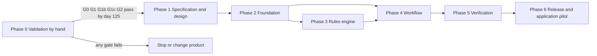

# Execution plan — PayClock

Labels and IDs: [Decision.md section 0](Decision.md#0-how-numbers-and-claims-are-labelled). Structure: phase, milestone, task, subtask. Estimates are ranges in hours `[A]`. Nothing here has been executed. Owner roles: **Founder** (sales, product, operator), **Rules lead** (the person who encodes and checks rules; the founder until someone else is named), **Engineer**, **Checker** (a named team member other than the person who computed or drafted; recomputes every date independently and approves rule versions; stands in for the founder on alerts), **Lawyer** (external, Ontario).

## 1. Sequence and gates

No Phase 1-6 task starts before `T-0.3.4` records a "build" decision. Paid pilots in Phase 0 are delivered by hand ([Decision.md 5.1](Decision.md#51-what-the-pilot-is)).

## 2. External dependencies

| Dependency | Needed by | Kind |
|---|---|---|
| Lawyer engaged and paid CAD 700 `[C]` | `T-0.1.3` | Payment, permission |
| Written answers to LQ-01, LQ-02, LQ-03 ([Decision.md section 6](Decision.md#6-dates-and-templates-not-legal-advice-what-that-rests-on)); fee not known | `T-0.2.1` (LQ-01), `T-0.2.3` (LQ-02), `T-0.3.1` (LQ-02, LQ-03) | Permission |
| Checker named | `T-0.1.2` | Decision |
| Prospect's aging list and facts | `T-0.2.3` | Sample data |
| Pilot fee CAD 99 received | `T-0.3.2` | Payment |
| Founder's own trial accounts on PaySub and Tiercord | `T-0.1.4` | Permission (founder's own action) |
| Founder accepts revised stop rule and tier limits | `T-0.2.1`, `T-0.3.1` | Buyer-side decision by founder |
| Build decision | `T-1.1.1` | Gate |
| Pilot customers consent to move hand-run data into the application | `T-6.1.4` | Permission |
| Hosting location decision | `T-2.1.4` | Decision |

## 3. Phases, milestones and tasks

### 3.1 Hand-run controls (Phase 0)

Phase 0 gives real firms real last days with no engine behind them. These controls stand in for [Decision.md 4.5](Decision.md#45-how-a-corrected-event-changes-dependent-dates) until the application exists.

| ID | Control |
|---|---|
| HR-1 | Every schedule is a numbered version per firm: "Schedule v3, issued 2026-12-14, supersedes v2 of 2026-12-07" on every page, with the rule-table version and the facts it rests on, each marked confirmed, estimated or not known |
| HR-2 | The Rules lead computes; the Checker recomputes every date from the facts without seeing the result, and signs. A date the two do not agree on is not sent. About 0.5 hour per report |
| HR-3 | Rights dates are shown as the un-extended last day and an act-by date, "no later than" when a trigger is unknown (same display rule as the application) |
| HR-4 | Correction log, one row per change: firm, invoice, fact, old value, new value, source, reason, who, when, each old and new date, version issued, how the owner was told |
| HR-5 | When a lien or adjudication date moves earlier: the same day, a new version is issued, the owner is telephoned, and an email confirms the call and asks the firm to delete earlier versions. Every weekly email states the current version number and is filed as the send record |
| HR-6 | Emails carry the schedule as an attachment named by version; the body names no contractor, owner or amount. Customer files are kept in one folder per firm and deleted 90 days after a pilot that does not convert |

### Phase 0 — Validation before building

#### Milestone M0.1 — Rules by hand and prospect list
Entry: founder accepts [Decision.md section 12](Decision.md#12-open-decisions-for-the-founder) items 1-3. Dependencies: lawyer. Owner: Founder. Outcome: a signed rule spreadsheet, a counted prospect list, gate G0 answered, and LQ-01 to LQ-03 answered in writing. Exit: `T-0.1.1` to `T-0.1.5` accepted.

| ID | Link | Owner | Est. | Deliverable | Acceptance check | Subtasks |
|---|---|---|---|---|---|---|
| T-0.1.1 | GTM prospect list | Founder | 6-10 | Spreadsheet of distinct prospects with the count | Distinct count and emailable count stated; for every email address the page where it is published and the date seen are recorded, with any "no unsolicited email" statement; no address from a contact-data tool is marked emailable; duplicates removed by firm name and domain; disqualifiers marked; if under 635, backup channel chosen before `T-0.2.1` | Transcribe three directories; record publication source per address; dedupe; count |
| T-0.1.2 | MH-03, MH-04, MH-05 | Rules lead | 12-18 | Rule spreadsheet v0: every `CLK-nn` with trigger, count, section, version; holiday list for 2026-2027 | Reproduces the synthetic examples in Decision 4.5 and the dates in `UT-01` to `UT-11` and `UT-15` to `UT-19` by formula; the Checker reproduces them independently; termination, Form 8 publication and completion are separate columns | Copy section text from `SRC-01`; build date formulas; build fixtures; Checker recomputation (4-6 hours of the Checker's time) |
| T-0.1.3 | L-01, L-02, L-03 | Founder, Lawyer | 6-10 | Signed memo on the rule table; disclaimer; pilot agreement; six template wordings; answers to L-05 to L-09 and L-11 | Memo dated and signed; each open legal question answered or marked "not computed" | Brief the lawyer; send spreadsheet; revise; file memo hash |
| T-0.1.4 | Gate G0 | Founder | 4-6 | Written comparison from the founder's own PaySub and Tiercord trials using the synthetic subcontract with EV-01 unknown | States, with screenshots kept outside this repository, how each dates the invoice and whether it prompts for the upstream date; G0 decided | Create trials; enter scenario; try the free tools with the same facts; record; decide |
| T-0.1.5 | LQ-01, LQ-02, LQ-03 | Founder, Lawyer | 3-5 | Written answers to the three legal questions; the outreach footer and unsubscribe procedure; the form in which reports may be delivered; liability cap and insurance quote | LQ-01 answered before any message is sent; LQ-02 before any report is delivered; LQ-03 before any pilot is sold; if LQ-02 forbids the service, the fallback in Decision section 6 is adopted and recorded | Put questions; receive answers; adjust messages, agreement and plan |

#### Milestone M0.2 — Outreach and 20 free reports
Entry: M0.1 exit; G0 not failed; LQ-01 and LQ-02 answered. Dependencies: prospect data. Owner: Founder. Outcome: 20 hand-run reports delivered and M-01 tallied. Exit: 20 reports sent or day 70 reached.

| ID | Link | Owner | Est. | Deliverable | Acceptance check | Subtasks |
|---|---|---|---|---|---|---|
| T-0.2.1 | GTM channel | Founder | 100-110 | 100 new prospects contacted per week to day 90, logged (35 hours per 30 days) | Every message carries sender identification, mailing address and an unsubscribe line; email goes only to addresses marked emailable in `T-0.1.1`; unsubscribes honoured the same day and logged; weekly log shows sent, replies, meetings; reply rate computed after 300 | Day 0 email; day 2 call; day 5 and day 12 follow-ups; log; suppression list |
| T-0.2.2 | GTM discovery, M-10 | Founder | 25-30 | Call notes per firm using the eight discovery questions listed in [Decision.md section 9](Decision.md#9-go-to-market-plan) | Notes filed for every meeting; the G1c answer recorded yes or no; disqualifiers applied | Schedule; run call; request aging list and facts |
| T-0.2.3 | M-01, MH-04, MH-05 | Rules lead, Checker | 45-60 | Free deadline report per firm (PDF) for 20 to 34 firms, and a tally row: invoices, invoices with EV-01 unknown, applicability unknown, notices received, rights clocks within 30 days. Checker: 10-17 further hours | LQ-02 answered first; every invoice dated or marked "not computable: missing fact"; HR-1 to HR-3 followed and the Checker's signature on each version; delivered within 2 business days | Load spreadsheet; compute; check; write cover note; send |
| T-0.2.4 | Invalidation test | Founder | 3-5 | Notes from 3 construction-lawyer interviews `[C]` | Each answers: do subs act on dates; which facts are usually missing | Ask; record |

#### Milestone M0.3 — Paid pilots by hand and the decision
Entry: first report delivered. Dependencies: pilot fee. Owner: Founder. Outcome: gates G1, G1b, G1c, G2 evaluated on real payments. Exit: `T-0.3.4` signed by day 125.

| ID | Link | Owner | Est. | Deliverable | Acceptance check | Subtasks |
|---|---|---|---|---|---|---|
| T-0.3.1 | Pilot offer | Founder | 4-6 | One-page pilot agreement, invoice for CAD 99, payment link | LQ-02 and LQ-03 answered and reflected in the agreement; signed by the firm's owner; payment received before loading | Send agreement; collect payment; record start date |
| T-0.3.2 | Pilot delivery | Rules lead, Checker | 18-25 | Schedule within 2 business days; 4 weekly emails; up to 3 template drafts; review call. Checker: 6-10 further hours | Refund criterion (a) and (b) met for each pilot, or refund issued within 5 business days; HR-1 to HR-6 followed: every correction in the log, every earlier-moving rights date re-issued and telephoned the same day, each weekly email filed | Load; compute; Checker recomputes; weekly update; correction log; re-issue and call |
| T-0.3.3 | M-03, M-04 | Founder | 4-6 | Per pilot: dated actions with evidence, baseline, conversion outcome | M-04 computed with numerator and denominator; day-25 offer of the CAD 99 launch plan sent; subscription created by hand in the payment provider with the pilot credit; first recurring invoice settled or not recorded by day 45 of each pilot | Collect evidence; send offer; create subscription; record |
| T-0.3.4 | Stop rule | Founder | 2-3 | Decision record: G0, G1, G1b, G1c, G2, G3 with counts, on all pilots from the first 20 reports | One of: build, stop, change product; dated; counts match logs | Compute; write; file in the coordination folder, not here |

### Phase 1 — Specification and design

#### Milestone M1.1 — Specification frozen against Phase 0 findings
Entry: "build" decision. Dependencies: Phase 0 reports and memo. Owner: Founder. Outcome: documents updated; golden fixtures defined. Exit: all four tasks accepted.

| ID | Link | Owner | Est. | Deliverable | Acceptance check | Subtasks |
|---|---|---|---|---|---|---|
| T-1.1.1 | MH-03 to MH-05 | Rules lead | 8-12 | Rule tables as data for `ON-NOPP`, `ON-2019-10`, `ON-2026-01`; 200 golden cases including every Phase 0 invoice (anonymised to synthetic names) | Each case has expected output checked against the signed spreadsheet | Convert; anonymise; review |
| T-1.1.2 | All MH | Founder | 4-6 | PRD and App-flow revised from pilot findings | Every change traced in the verification matrix | Review notes; edit; re-run document checks |
| T-1.1.3 | S-03, S-07, S-08, S-09, S-10 | Engineer | 8-12 | Wireframes for five principal screens | Each DD-01 to DD-10 visible in a wireframe | Draw; review with one pilot user |
| T-1.1.4 | L-01, L-02, MH-09 | Founder, Lawyer | 6-10 | Signed memo for the data-form rule tables; terms and privacy notice naming the processors in TRD 8.10 | Memo hash recorded for each version | Send; revise; file |

### Phase 2 — Foundation

#### Milestone M2.1 — Repository and environments
Entry: M1.1 exit. Owner: Engineer. Outcome: a new clone runs locally with one command; staging exists. Exit: `IT-14` passes.

| ID | Link | Owner | Est. | Deliverable | Acceptance check | Subtasks |
|---|---|---|---|---|---|---|
| T-2.1.1 | R-03, R-04 | Engineer | 4-6 | Monorepo with `apps/web`, `apps/worker`, five packages; import-boundary lint; duplicate-utility check | Lint fails on a deep import and on `packages/rules` importing anything external | Scaffold; lint rules; CI hook |
| T-2.1.2 | R-17 | Engineer | 4-6 | Single start command with health checks; synthetic seed | Fresh clone to ready in one command; unhealthy dependency fails loudly | Compose file; health endpoints; seed |
| T-2.1.3 | Quality | Engineer | 3-5 | CI: lint, types, unit, integration, migration checks | Red on any failing check | Pipeline; caches |
| T-2.1.4 | R-15, AD-09 | Engineer | 4-6 | Staging and production projects in Canadian regions; managed database; no local state in containers | Recreating services loses no data; region evidence recorded | Provision; secrets; domains |
| T-2.1.5 | R-06, R-07, R-12 | Engineer | 3-5 | `packages/platform`: config, logger, correlation, queue client | Worker starts with no web import; correlation id present in request, job and mail logs; redaction test passes | Config schema; logger; propagation |

#### Milestone M2.2 — Schema, tenancy, identity
Entry: M2.1 exit. Owner: Engineer. Outcome: isolation proven by test. Exit: `IT-01`, `IT-02`, `IT-10`, `IT-11` pass.

| ID | Link | Owner | Est. | Deliverable | Acceptance check | Subtasks |
|---|---|---|---|---|---|---|
| T-2.2.1 | MH-10, R-05 | Engineer | 10-14 | Migrations for all tables in [schema.md](schema.md); row-level security; tenant-scoped client | `IT-01` passes; no query path without tenant setting | Tables; policies; client; tests |
| T-2.2.2 | MH-10 | Engineer | 6-10 | Sign-in, TOTP, roles, invitations, `read` and `assisted_load` grants, password screening, sign-in delays | `IT-02` passes | Auth wiring; role checks; grant scopes; delays |
| T-2.2.3 | R-08, R-09, R-10, R-11 | Engineer | 5-8 | Migration order check; ORM parity check; resumable backfill runner; concurrent-index convention | `IT-10` passes | Scripts; CI steps; documentation |
| T-2.2.4 | R-13, R-16 | Engineer | 4-6 | Storage key builder; signed links from `APP_PUBLIC_URL`; upload validation | `IT-11` passes | Key function; link builder; validators |
| T-2.2.5 | MH-06 | Engineer | 3-5 | Audit writer used by every use case | Each listed action writes one audit row | Writer; hooks |

### Phase 3 — Rules engine

#### Milestone M3.1 — Deterministic clocks
Entry: `T-1.1.1`, `T-2.1.1`. Owner: Rules lead. Outcome: every golden case reproduced. Exit: `UT-01` to `UT-19` pass; brief's gate "All pilot invoices reproduce the manual dates exactly" `[C]` met.

| ID | Link | Owner | Est. | Deliverable | Acceptance check | Subtasks |
|---|---|---|---|---|---|---|
| T-3.1.1 | MH-04 | Rules lead | 6-8 | Civil-date arithmetic and holiday calendar | `UT-01` to `UT-04` | Date type; holiday loader; extension rule |
| T-3.1.2 | MH-03 | Rules lead | 8-12 | Version selector and applicability | `UT-08` | Governing-date logic; unknown handling |
| T-3.1.3 | MH-04 | Rules lead | 10-14 | CLK-01 to CLK-08 and the CLK-17 composition, paths A to H | `UT-05` to `UT-07`, `UT-17` to `UT-19` | Trigger evaluation; path table; per-amount handling; missing-fact output |
| T-3.1.4 | MH-05 | Rules lead | 8-12 | CLK-09 variants a and b, CLK-10 to CLK-12, termination handling with distinct event types, pending-question withholding, act-by | `UT-10`, `UT-11`, `UT-15`, `UT-16` | Earliest-of; variants; in-time test for Form 8; bound; buffer |
| T-3.1.5 | MH-11 | Rules lead | 6-10 | CLK-13, CLK-14 and transition flag L-07 | `UT-11` | Anniversary; window; transition |
| T-3.1.6 | MH-04 | Rules lead | 4-6 | Interest calculation with rate table | `UT-09` | Cents arithmetic; rounding |
| T-3.1.7 | M-06 | Rules lead | 6-10 | Golden-case runner in CI | `UT-12`, `UT-13` | Loader; diff report |

### Phase 4 — Workflow

#### Milestone M4.1 — Intake
Entry: M2.2 exit. Owner: Engineer. Outcome: a 40-row list loaded with every row accounted for. Exit: `IT-09` passes.

| ID | Link | Owner | Est. | Deliverable | Acceptance check | Subtasks |
|---|---|---|---|---|---|---|
| T-4.1.1 | MH-01 | Engineer | 8-12 | Project, subcontract, invoice APIs and S-04, S-05 forms | Duplicate invoice returns 409 | Use cases; forms; validation |
| T-4.1.2 | MH-01, R-19 | Engineer | 8-12 | CSV import with mapping, per-row results, resume, retry of rejected rows (S-06) | `IT-09` | Parser; job; results screen |

#### Milestone M4.2 — Events and recomputation
Entry: M3.1 and M4.1 exit. Owner: Engineer. Outcome: no stale date after any correction. Exit: `IT-03` to `IT-08`, `E2E-02` pass.

| ID | Link | Owner | Est. | Deliverable | Acceptance check | Subtasks |
|---|---|---|---|---|---|---|
| T-4.2.1 | MH-02 | Engineer | 6-10 | Event API and S-08 with certainty, unknown, evidence | "Unknown" saves; `IT-06` | Use case; editor; upload |
| T-4.2.2 | MH-06, R-01 | Engineer | 10-14 | In-transaction recompute; fact-version compare-and-set for jobs; batch recompute | `IT-03`, `IT-04`, `IT-05` | Transaction; locking; job; invariant check |
| T-4.2.3 | MH-06 | Engineer | 8-12 | S-09 diff; stale marking; L-10 flag; urgent alert | `IT-07`, `E2E-02` | Diff query; marks; alert |
| T-4.2.4 | R-02 | Engineer | 4-6 | Reconciliation sweeper; "check status" on timeout | `IT-08`, `E2E-09` | Sweeper; status endpoint |

#### Milestone M4.3 — Dashboard, reminders, templates, reports
Entry: M4.2 exit. Owner: Engineer. Outcome: the pilot promise can be delivered in the application. Exit: `E2E-01`, `E2E-03` to `E2E-06` pass.

| ID | Link | Owner | Est. | Deliverable | Acceptance check | Subtasks |
|---|---|---|---|---|---|---|
| T-4.3.1 | MH-07, MH-04, MH-05 | Engineer | 12-16 | S-03 and S-07 | Order and groups as specified; every date shows trigger and certainty | Queries; components; states |
| T-4.3.2 | MH-07 | Engineer | 8-12 | Reminder scheduler (act-by and last-day series), weekly digest with send record, email content rule DD-09, failed-reminder surfacing | `IT-08`, `IT-16` | Schedule; send; digest |
| T-4.3.3 | MH-08 | Engineer | 10-14 | Six templates, gating, PDF, mark-sent (S-10); decision on tagged PDFs | `UT-14`, `E2E-01` | Merge; gate; PDF; form |
| T-4.3.4 | MH-11 | Engineer | 6-8 | S-11 holdback ledger | Balance equals retained minus released | Ledger; events |
| T-4.3.5 | MH-09, MH-03 | Engineer | 5-8 | Flags, lawyer tags, S-14 rule library | Each L-code reachable from a fixture | Flag rules; library |
| T-4.3.6 | MH-12 | Engineer | 8-12 | S-16 pilot report, export, deletion | `IT-13` | Report; export job; deletion job |
| T-4.3.7 | R-18, R-20 | Engineer | 4-6 | URL state, form persistence, link checker | `E2E-04`, `E2E-06` | Router state; storage; crawler |
| T-4.3.8 | MH-03 | Engineer | 6-8 | S-15 operator console with impact preview and two-person approval | `IT-12` | Draft; preview; approve |
| T-4.3.9 | MH-13 | Engineer | 10-14 | Checkout, pilot credit, webhook handler, plan limits, grace and read-only states, billing panel on S-13 | `IT-15` | Checkout session; webhook verify and dedupe; state sync; limits; states |

### Phase 5 — Verification

#### Milestone M5.1 — Test hardening
Entry: M4.3 exit. Owner: Engineer. Outcome: all planned checks run and recorded. Exit: results entered in [verification-report-fixing.md](verification-report-fixing.md); no open high-severity defect.

| ID | Link | Owner | Est. | Deliverable | Acceptance check | Subtasks |
|---|---|---|---|---|---|---|
| T-5.1.1 | All MH | Engineer | 12-18 | Complete automated suites | All `UT`, `IT`, automated `E2E` green | Fill gaps; stabilise |
| T-5.1.2 | Threat model | Engineer | 5-8 | Review against the ASVS requirements cited in TRD 8 | Each recorded as met, not met, or not applicable with evidence | Walk list; fix; record |
| T-5.1.3 | Design 6 | Engineer | 5-8 | Manual accessibility checks | `E2E-07`, `E2E-08` recorded per criterion | Keyboard; reader; zoom; measure |
| T-5.1.4 | Restore | Engineer | 3-5 | Backup and restore drill | Restore within 4 hours; invariants pass; deletion ledger re-applied | Restore; check; time it |
| T-5.1.5 | TRD 10 | Engineer | 4-6 | Load and concurrency test | Targets in TRD 10 met or recorded as missed | Scripts; run; report |

### Phase 6 — Release and application pilot

#### Milestone M6.1 — Release and operations
Entry: M5.1 exit. Owner: Founder. Outcome: production running with alerts and cleanup. Exit: rollback rehearsed.

| ID | Link | Owner | Est. | Deliverable | Acceptance check | Subtasks |
|---|---|---|---|---|---|---|
| T-6.1.1 | Release | Engineer | 4-6 | Production deploy; rollback rehearsal | Previous image restored in under 15 minutes | Deploy; rehearse |
| T-6.1.2 | Monitoring | Engineer | 4-6 | Alerts: invariant failure, queue age, failed reminders, readiness, error rate | Each alert fired once in staging | Dashboards; routes |
| T-6.1.3 | R-14 | Engineer | 3-5 | Retention and cleanup jobs | Expired import file removed; failure alerts | Sweep; alert |
| T-6.1.4 | Pilot continuity | Rules lead | 4-6 | Hand-run pilot data loaded | Every application date equals the hand schedule, or the difference is explained to the customer | Import; compare; explain |

#### Milestone M6.2 — Application pilot delivered and decided
Entry: M6.1 exit; at least 3 paying or pilot accounts. Owner: Founder. Outcome: M-03, M-04, M-06, M-07 measured in the application. Exit: expansion decision recorded.

| ID | Link | Owner | Est. | Deliverable | Acceptance check | Subtasks |
|---|---|---|---|---|---|---|
| T-6.2.1 | M-02 to M-07 | Founder | 12-20 | 30 days of application pilots | Weekly digest sent 4 times per account; metrics computed | Onboard; support; measure |
| T-6.2.2 | PRD 13 | Founder | 3-5 | Review against expansion evidence | Each expansion item marked met or not | Collect; decide |
| T-6.2.3 | R-21, R-22 | Founder | 2-3 | Scope audit and branch hygiene | Every merged change maps to an MH or R; no stale or misnamed branch; unmerged work listed | List; prune; record |

## 4. Parallel work and critical path

- Critical path: `T-0.1.2` -> `T-0.1.3` -> `T-0.2.3` -> `T-0.3.2` -> `T-0.3.4` -> `T-1.1.1` -> `T-3.1.3` -> `T-4.2.2` -> `T-4.3.1` -> `T-5.1.1` -> `T-6.1.1` -> `T-6.2.1`.
- Parallel: `T-0.1.1` and `T-0.1.4` with `T-0.1.2`; `T-0.2.1` with `T-0.2.3`; Phase 3 with M2.2 and M4.1; `T-4.3.4`, `T-4.3.5`, `T-4.3.8` with `T-4.3.1`.

## 5. Estimate summary

| Phase | Low | High |
|---|---|---|
| 0 Validation (founder and Rules lead; the Checker's 20-33 hours are extra) | 232 | 294 |
| 1 Specification and design | 26 | 40 |
| 2 Foundation | 46 | 71 |
| 3 Rules engine | 48 | 72 |
| 4 Workflow | 113 | 164 |
| 5 Verification | 29 | 45 |
| 6 Release and pilot | 32 | 51 |
| Build, phases 1-6 | 294 | 443 |

The brief's development estimate is 110 hours / 14 days `[C]`. This plan's build range is 2.7 to 4.0 times that; the brief's figure did not include tenancy, recomputation audit, billing, verification or release work. Valued at the brief's CAD 100 per hour `[C]`, 294-443 hours is CAD 29,400-44,300 against 11,000. Phase 0: the recurring tasks `T-0.2.1`, `T-0.2.2`, `T-0.2.3`, `T-0.3.2` total 188-225 hours to day 90, consistent with the 216 founder hours in [Decision.md section 9](Decision.md#9-go-to-market-plan); setup and decision tasks add 44-69. The difference is unreconciled and is listed in the outstanding items.

## 6. Proposed scripts and commands

Proposed unless marked. Exist since B1 (2026-11-11), under `workspace/`: `make dev` (as `scripts/dev.ts`, services run directly, no Compose), `scripts/seed-synthetic`, `scripts/check-migrations` (built into `npm run db:migrate` and `IT-10`), `scripts/orm-parity`, `scripts/golden-verify`. Not yet: `scripts/backfill-runner`, `scripts/link-check`, `scripts/restore-drill`.

| Script | Purpose | Inputs | Outputs | Failure behaviour |
|---|---|---|---|---|
| `make dev` | Start local stack | `.env.local` (synthetic) | Running services, "ready" line | Exits non-zero naming the unhealthy service |
| `scripts/seed-synthetic` | Load synthetic tenants and the Decision 4.5 example | None | Seeded database | Refuses to run outside local and staging |
| `scripts/check-migrations` | Detect conflicting migration order | Branch, main | Pass or list of conflicts | Non-zero; CI fails |
| `scripts/orm-parity` | Diff ORM schema against migrated database | Database URL | Empty diff or differences | Non-zero on any difference |
| `scripts/backfill-runner` | Run a backfill in resumable batches | Backfill name, batch size | Checkpoint rows, progress | Stops on error; resumes from checkpoint |
| `scripts/golden-verify` | Run golden cases against the engine | Case file, rule versions | Pass count, diff per failure | Non-zero on any mismatch |
| `scripts/link-check` | Crawl routes and email links | Base URL, session | Broken links list | Non-zero on any broken link |
| `scripts/restore-drill` | Restore latest backup to a scratch instance and run invariants | Backup id | Timing, invariant report | Non-zero; never touches production |

## 7. Test catalogue

Status per test: [verification-report-fixing.md section 9](verification-report-fixing.md#9-build-milestone-b1-2026-11-11); everything not listed there is `Not run`. No fixture asserts a result that depends on an open legal question (L-07, L-08, L-09, the old s. 31(6)-(7)); those parts are marked pending and the test asserts that the dependent output is withheld. Fixtures are synthetic: Northline Electric Ltd. (tenant A), Baycrest Mechanical Inc. (tenant B), contractor Harbourgate Builders Inc., project Lakeshore Clinic Fit-out, prime contract 2026-02-10, procurement start 2025-11-03, invoice INV-1042 for CAD 48,000 with CAD 4,800 holdback.

### 7.1 Unit tests (rules package, no database)

| ID | Fixture and action | Expected |
|---|---|---|
| UT-01 | EV-01 2026-10-08 (Thu); compute CLK-04 | 2026-11-12 |
| UT-02 | EV-01 2026-10-04; CLK-04 raw day is Sunday 2026-11-08 | 2026-11-09 |
| UT-03 | EV-01 2026-10-07; raw day 2026-11-11 is Remembrance Day | 2026-11-12 |
| UT-04 | EV-01 2026-10-03; raw day is Saturday 2026-11-07 | 2026-11-07 (Saturday is not a holiday) |
| UT-05 | EV-01 and EV-02 2026-10-08; EV-04 2026-11-02 (within time), full payment; then partial payment of 60% | Path A: CLK-17 2026-11-09. Path B: paid portion 2026-11-09, remainder 2026-11-12 under path C |
| UT-06 | EV-03 2026-10-20; then no owner notice with EV-01 2026-10-08; EV-05 Form 1.2 on 2026-10-27 | CLK-05 2026-10-27; then 2026-11-12; CLK-06 2026-11-17 |
| UT-07 | EV-01 unknown, EV-07 2026-09-18 | CLK-03, CLK-04, CLK-05, CLK-16 `not_computable` with missing fact EV-01; CLK-09 and CLK-11 `computed` or `provisional`; no clock passes |
| UT-08 | EV-11 2019-09-30 with EV-12 2019-06-03; EV-11 2019-10-01 with EV-12 2019-09-15; EV-11 2018-06-30; EV-11 2026-02-10 with EV-12 unknown; EV-11 2026-02-10 with EV-12 2025-11-03 | `ON-NOPP`; `ON-NOPP`; `ON-LEGACY` not computed; `not_computable` + L-06; `ON-2026-01` |
| UT-09 | Arithmetic only: CAD 43,200.00 unpaid from 2026-11-13 for 30 days at a synthetic 4.00% | CAD 142.03. Which rate applies is pending L-09: no customer-facing interest amount is produced, and the test asserts the output is withheld while the rule row carries `pending_question` |
| UT-10 | No certificate (variant b). EV-07 2026-09-30; then corrected to 2026-09-18; then EV-08 set to unknown | CLK-09b last day 2026-11-29 (a Sunday, shown un-extended), act-by 2026-11-19, CLK-10 2027-02-27; then 2026-11-17, act-by 2026-11-07, CLK-10 2027-02-15 (Family Day, shown un-extended); the extended days are **not asserted**: that part of the fixture is pending L-09 and the test asserts the extended output is withheld with the flag. With EV-08 unknown: state `provisional`, bound `no_later_than`, missing EV-08 |
| UT-11 | EV-07 2026-09-18; EV-11 2026-02-10; EV-13 2027-02-22; EV-11 2025-05-01 | CLK-11 2026-12-17; Form 6 by 2027-02-24; owner payment window 2027-04-23 to 2027-05-07; pre-2026 contract gives L-07, no date |
| UT-12 | 200 golden cases | 200 equal |
| UT-13 | Same facts in shuffled order; add a flag to one clock | Identical outputs and `inputs_hash`; other clocks unchanged |
| UT-15 | EV-17 2026-09-10, EV-18 2026-09-15 (in time), EV-07 2026-09-16; then EV-18 2026-09-21 (late); then EV-17 unknown with EV-18 2026-09-15 | CLK-09b 2026-11-14 (from publication), CLK-11 2026-12-09 (from actual termination): different bases. Late Form 8: CLK-09b 2026-11-09 with L-11, CLK-11 unchanged. EV-17 unknown (ceiling rule): CLK-11 "no later than 2026-12-14" (EV-18 + 90: 15 + 31 + 30 + 14 days; earlier than EV-07 + 90 = 2026-12-15, which must not be shown), CLK-09b "no later than 2026-11-14"; both `provisional`, bound `no_later_than`, missing EV-17, L-11; no `exact` date results from EV-18 for CLK-11 in any case |
| UT-16 | EV-19 2026-08-25, EV-08 2026-09-01, supply continues to EV-07 2026-10-15; then EV-08 and EV-19 unknown | Two liens: CLK-09a 2026-10-31, CLK-09b 2026-12-14. Unknown publication: one date "no later than 2026-12-14", `provisional`; reminders carry the "may be earlier" wording; s. 39(4) request offered |
| UT-17 | EV-01 and EV-02 2026-10-08; owner pays late, EV-04 2026-11-07 (day 30); no notice | Path C: CLK-17 2026-11-12, not 2026-11-14; CLK-16 2026-11-13 |
| UT-18 | Same invoice and facts as UT-17; Form 1.3 given and received 2026-10-28 (day 20) for the full CAD 43,200; then for CAD 10,000 only | Path E: no due date, "disputed by notice", not overdue on 2026-11-20, no CLK-16, L-05. Partial: CAD 33,200 due 2026-11-12 under path C; CAD 10,000 path E |
| UT-19 | Same invoice; Form 1.2 received 2026-11-13 (day 36), day given unknown, with the UT-17 late payment; then, without that payment, Form 1.2 given 2026-10-28 and owner pays that amount on 2026-12-01 | Path F: CLK-17 2026-11-12 `provisional`, L-05, interest statement refused. Path D: suspended, CLK-06 2026-11-18; after payment CLK-17 2026-12-08 |
| UT-14 | Interest statement requested with EV-01 `estimated` | Refused with reason; reminder template allowed with non-statutory wording |

### 7.2 Integration tests (real database, fake providers)

| ID | Fixture and action | Expected |
|---|---|---|
| IT-01 | Tenant B user requests tenant A invoice, recomputation, document link, export; worker job without tenant | 404 each; job fails without reading data |
| IT-02 | Viewer posts a correction; member deletes workspace; operator reads invoices without grant; operator with `read` grant posts an invoice; operator with `assisted_load` grant posts an invoice and an event, tries to mark an action sent, and acts after expiry | 403; 403; no rows; 403; created, event saved `estimated` with `entered_by_operator`, each write audited and listed for the owner; 403; 403 |
| IT-03 | Fault injected after deadlines insert during a correction | Event, deadlines, reminders, audit all unchanged |
| IT-04 | Two corrections of the same event at once | One succeeds; one gets 409 with the newer value |
| IT-05 | Batch recompute reads fact version 3, a correction commits version 4, batch then tries to write; same job delivered twice | Batch result discarded and requeued; one current deadline per clock |
| IT-06 | `POST /events` repeated with one idempotency key | One event |
| IT-07 | Draft action and sent action depend on CLK-16; EV-01 corrected; EV-07 corrected so CLK-09 act-by is within 14 days | Draft `stale`; sent action flagged `STALE_SENT` and L-10; one urgent reminder to the owner |
| IT-08 | Reminder scheduled for a deadline later superseded; provider accepts after our timeout | Not sent, `cancelled`; second case reconciled to `sent` with no second email |
| IT-09 | 40-row CSV with 4 duplicates and 5 invalid; worker killed at row 20; same file re-uploaded | 31 created, 4 duplicate, 5 rejected; no duplicates after resume; same batch returned |
| IT-10 | Schema built from migrations versus ORM; backfill interrupted; two branches add migrations; index created on a table under write load | Empty diff; resume completes; CI fails on order; writes not blocked |
| IT-11 | Upload a renamed executable as PDF; request a link; wait past expiry; expired import file | 415; link host equals `APP_PUBLIC_URL`; expired link refused; file swept |
| IT-12 | Approve rule version without memo hash; edit approved version; trace one correlation id | Refused; refused; id present in request, job and mail logs; no amounts or names in logs |
| IT-13 | Delete tenant A; restore last backup; open access | Rows and objects gone; deletion ledger re-applied before access |
| IT-15 | Checkout completes for a pilot workspace; the same webhook event delivered twice; "payment failed" delivered after a later "paid"; 8 days past due; invoice count over plan limit | `tenant.plan` = `launch`; subscription active from day 31 with CAD 99 credit consumed by the first invoice; one `billing_event` row, no change on the duplicate; state equals the provider's current state; workspace read-only with every deadline still visible and rights reminders still scheduled; new invoice refused, existing ones unaffected |
| IT-16 | Render every reminder and digest email for the synthetic tenant; send the weekly digest twice in one ISO week | No amount, invoice number, contractor or owner name in any subject or body; one `digest_send` row with status sent and the deadline ids |
| IT-14 | Start worker alone; start stack from a fresh clone; recreate services | Worker healthy without web modules; "ready" with all health checks; data intact |

### 7.3 End-to-end tests (browser)

| ID | Actions | Expected |
|---|---|---|
| E2E-01 | Onboard; import; confirm facts; open invoice; generate EV-01 date request; mark sent with copy; open pilot report | Report shows one dated action with evidence |
| E2E-02 | Correct EV-07 to an earlier date | Diff lists CLK-09 first as moved earlier; owner alert sent (no names or amounts in the email); the old date appears only with the visible and programmatic label "Superseded" |
| E2E-03 | Invoice with EV-01 unknown; later confirm the date | Payment clocks "not computable" with one action; after confirmation they show dates |
| E2E-04 | Refresh mid-form; Back after save; open an emailed deep link signed out; double-click save | Text kept; no resubmission; lands on target after sign-in; one record |
| E2E-05 | Viewer opens S-08; sign out; press Back | Permission-denied state; no data shown |
| E2E-06 | Crawl navigation and email links | No broken or stale route |
| E2E-07 | Manual: keyboard-only import and correction; contrast; 320 px reflow; target size | Each criterion in design section 6 recorded pass or fail |
| E2E-08 | Manual: screen reader on S-08 error, conflict and timeout, and on S-09 after a lien correction | Summary focused; conflict and timeout announced with focus on the message; on S-09 the heading is focused and the reader says which lien date is superseded and which is current |
| E2E-09 | Drop the network during save; slow upload | Timeout state; "check status" resolves truthfully |

## 8. Monitoring, rollback and restore

Monitoring `T-6.1.2`; rollback `T-6.1.1`; restore `T-5.1.4`; retention `T-6.1.3`. Details: [TRD.md section 7](TRD.md#7-deployment-view).
