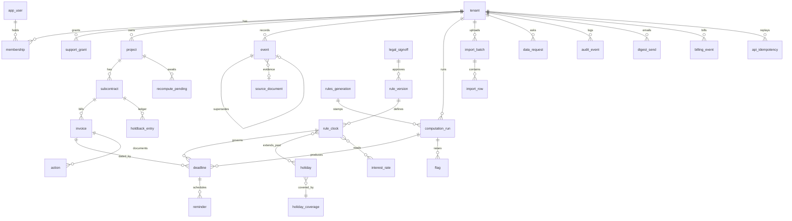

# Schema — PayClock

Labels and IDs: [Decision.md section 0](Decision.md#0-how-numbers-and-claims-are-labelled). Postgres 16. Since B1 (2026-11-11) the core tables exist in `workspace/packages/db/migrations/20261111T100000_core.sql` with the matching ORM model in `workspace/packages/db/src/schema.ts`; tables marked "not in B1" below are still proposed. Synthetic examples only.

## 1. Entity-relationship diagram

## 2. Conventions

- Keys: `id uuid` primary key, default `gen_random_uuid()`, unless stated. `created_at timestamptz not null default now()` on every table.
- Tenant tables carry `tenant_id uuid not null references tenant(id)`; composite foreign keys include `tenant_id` so a child cannot point at another tenant's parent.
- Legal dates are `date` (civil date, America/Toronto). Money is `bigint` cents. Enumerations are Postgres enums.
- Sensitivity: **C** confidential business data (amounts, counterparties, disputes), **P** personal information (names, emails), **I** internal.

## 3. Dictionary

### Tenant and identity

| Table | Fields (type; null; default; constraint) | Sens. |
|---|---|---|
| `tenant` | `legal_name text`; `trade text null`; `digest_weekday smallint default 1 check 0..6`; `disclaimer_version text null`; `disclaimer_accepted_at timestamptz null`; `baseline_notices_30d int null`; `plan` enum(pilot, launch, starter, pro, business) default pilot (`launch` is the single CAD 99 plan of MH-13; the three tiers are unused until introduced); `billing_ref text null unique`; `subscription_status` enum(none, active, past_due, read_only, cancelled) default none; `current_period_end date null`; `pilot_started_on date null`; `pilot_ends_on date null`; `pilot_fee_cents bigint null`; `converted_on date null`; `status` enum(active, locked, deleting) default active; `deleted_at timestamptz null` | C |
| `app_user` | `id uuid` = auth subject; `email citext unique`; `display_name text`; `is_operator bool default false` | P |
| `membership` | `tenant_id`; `user_id` fk; `role` enum(owner, member, viewer); `status` enum(invited, active, removed) default invited; unique(`tenant_id`,`user_id`); check: at least one active owner per tenant (trigger) | P |
| `support_grant` | `tenant_id`; `operator_id` fk; `granted_by` fk; `scope` enum(read, assisted_load); `expires_at timestamptz` check <= created_at + 72 h for read, + 35 days for assisted_load; `revoked_at timestamptz null` | I |

### Work records

| Table | Fields | Sens. |
|---|---|---|
| `project` | `tenant_id`; `name text`; `contractor_name text`; `owner_name text null`; `premises_leased` enum(yes, no, unknown) default unknown; `lease_first_entered_on date null`; `municipal_interest` enum(yes, no, unknown) default unknown; `fact_version int default 0`. The prime contract date and procurement start are events EV-11 and EV-12, not columns. There is deliberately no subcontract date anywhere: it selects nothing | C |
| `subcontract` | `tenant_id`; `project_id` fk; `reference text null`; `has_sub_subs bool null`; `holdback_rate numeric(5,4) default 0.1000`; `fact_version int default 0` | C |
| `invoice` | `tenant_id`; `subcontract_id` fk; `number text`; `given_to_contractor_on date null`; `amount_cents bigint check >= 0`; `holdback_cents bigint default 0 check >= 0`; `status` enum(open, paid, written_off) default open; `import_row_id uuid null`; `fact_version int default 0`; unique(`tenant_id`,`subcontract_id`,`number`) | C |
| `holdback_entry` | `tenant_id`; `subcontract_id` fk; `invoice_id uuid null`; `kind` enum(retained, released); `amount_cents bigint check > 0`; `on_date date`; `event_id uuid null` | C |
| `source_document` | `tenant_id`; `purpose` enum(evidence, import, action_pdf, sent_copy, export); `entity_type text`; `entity_id uuid`; `storage_key text unique`; `sha256 bytea`; `mime text`; `bytes int check <= 10485760`; `expires_at timestamptz null`; `uploaded_by` fk | C |

### Facts

| Table | Fields | Sens. |
|---|---|---|
| `event` | `tenant_id`; `scope_type` enum(project, subcontract, invoice); `scope_id uuid`; `event_type` enum(`EV-01`..`EV-19`), each a distinct value so that contract termination (EV-17), Form 8 publication (EV-18) and completion or abandonment (EV-09) cannot be stored as one another; `series_key text default 'main'` (distinguishes repeated events such as payments); `occurred_on date null`; `received_on date null` (EV-05 only: `occurred_on` is the day given, `received_on` the day the sub received it); `delivery_method text null`; `entered_by_operator bool default false`; `certainty` enum(confirmed, estimated, unknown); `amount_cents bigint null`; `notice_form` enum(1.2, 1.3) null (EV-05 only: Form 1.2 owner non-payment or Form 1.3 dispute, which select paths D and E); `document_id uuid null` (foreign key added with `source_document`, not in B1); `version int default 1`; `supersedes_id uuid null` fk self; `superseded_at timestamptz null`; `reason text null`; `created_by` fk. Checks: (`certainty = 'unknown'`) = (`occurred_on is null`); `entered_by_operator` implies `certainty <> 'confirmed'`; `reason` not null when `supersedes_id` is not null; `notice_form` not null exactly for EV-05; `received_on` only for EV-05; `event_scope_check` ties each type to its scope (invoice: EV-01 to EV-06; subcontract: EV-07, EV-10, EV-14 to EV-16; project: the others); a trigger requires the scope row to exist in the same tenant. No update except setting `superseded_at`; no delete (trigger) | C |

### Rules (global, no tenant)

| Table | Fields | Sens. |
|---|---|---|
| `legal_signoff` | `reviewer_name text`; `licence_jurisdiction text`; `memo_sha256 bytea`; `signed_on date`; `scope_note text` | I |
| `rule_version` | `code text` (for example `ON-2026-01`); `revision int default 1`, unique(`code`,`revision`), at most one non-retired revision per code (partial unique index): a changed version is a new revision and the old one is retired, never edited; `content_sha256 text` of the encoded content; `family text` (`ON-LEGACY`, `ON-NOPP`, `POST-2019`: the regime the version belongs to); `jurisdiction text default 'ON'`; `effective_from date`; `effective_to date null`; `status` enum(draft, approved, retired) default draft; `legal_source text`; `signoff_id uuid null`; check: approved implies `signoff_id` not null; rows immutable once approved (trigger) | I |
| `rule_clock` | `rule_version_id` fk; `clock_code text` (`CLK-01`..`CLK-17`); `variant text default ''` (`a`, `b` for CLK-09); `trigger_spec jsonb` naming event types explicitly (for example CLK-11: `{"earliest_of":["EV-09","EV-17","EV-10","EV-07"],"ceiling_if_unknown":{"EV-17":"EV-18"}}`, where a ceiling can only produce `bound = no_later_than`; CLK-09b: `{"earliest_of":["EV-07","EV-09",{"termination_for_lien":{"actual":"EV-17","published":"EV-18","in_time_days":7}},"EV-10"]}`); `pending_question text null` (for example `L-09`: dependent output withheld); `offset_days int`; `window_end_days int null`; `extend_on_holiday bool`; `act_by_buffer_days int default 0`; `section_ref text`; `applies_when jsonb`; `computed bool default true`; `not_computed_reason text null`; unique(`rule_version_id`,`clock_code`,`variant`) | I |
| `holiday` | pk(`jurisdiction`,`day date`); `name text`; `source text` | I |
| `holiday_coverage` | pk(`jurisdiction`,`year int`); `source text`. Years the holiday table is complete for; the engine computes no date that needs another year (B1: 2018-2040) | I |
| `rules_generation` | pk `jurisdiction`; `rules_gen int`; `holiday_gen int`; `changed_at`. Incremented in the transaction of any rule-version or holiday-table change | I |
| `recompute_pending` | `tenant_id`, `project_id` (composite fk to project); `cause`; `rules_gen`, `holiday_gen` (generation the recompute must reach); `attempts`; `last_error text null`; `done_at null`; one open row per project (partial unique index). Written with the change; drained by the worker; holds identifiers only, no row-level security; the runtime role may read and update, and queues stale projects only through the `enqueue_stale_recomputes()` function | I |
| `interest_rate` | `jurisdiction`; `effective_from date`; `effective_to date null`; `annual_rate numeric(6,4)` (decimal fraction, e.g. 0.0400); `source text`; no overlapping ranges, enforced by a trigger because `btree_gist` is not available | I |

### Computation

| Table | Fields | Sens. |
|---|---|---|
| `computation_run` | `tenant_id`; `scope_type`; `scope_id`; `cause` enum(new_event, correction, rule_version, holiday_table, import); `cause_event_id uuid null`; `fact_version_read int`; `inputs_hash bytea`; `engine_version text`; `status` enum(succeeded, discarded, failed); `rules_gen int`, `holiday_gen int` (generation the run used; a current deadline whose run is older is read as `recompute_pending`); `created_by uuid null` | C |
| `deadline` | `tenant_id`; `subcontract_id` fk; `invoice_id uuid null`; `clock_code text`; `variant text default ''`; `rule_clock_id` fk null (null only when no rule version covers the clock, so the state is `not_computable` or `not_applicable`); `computation_run_id` fk; `state` enum(computed, provisional, not_computable, not_applicable); `statutory_date date null`; `bound` enum(exact, no_later_than) default exact; `path text null` (CLK-17: A to H); `act_by_date date null`; `window_end_date date null`; `amount_cents bigint null` (CLK-17 and CLK-16: the amount the portion covers); `missing_facts text[] default '{}'`; `flags text[] default '{}'`; `withheld jsonb default '[]'` (outputs withheld pending a legal question, e.g. the extended day under L-09); `notes text[] default '{}'`; `trigger_event_ids uuid[]`; `is_current bool default true`; `superseded_by_run_id uuid null`. Checks: `state = 'computed'` implies `statutory_date` not null, `missing_facts = '{}'` and `bound = 'exact'`; `bound = 'no_later_than'` implies `state = 'provisional'`; a date exists exactly when the state is `computed` or `provisional`; those two states need `rule_clock_id`; a row that is not current names the run that superseded it. Only the supersession markers may be updated; no delete (trigger) | C |
| `flag` | `tenant_id`; `entity_type text`; `entity_id uuid`; `code text` (`L-01`..`L-11`, `STALE_SENT`); `raised_by_run_id uuid null`; `resolved_at timestamptz null`; `resolved_by uuid null`; `note text null` | C |
| `reminder` | `tenant_id`; `deadline_id` fk; `kind` enum(actby_d14, actby_d7, actby_d3, actby_d0, last_d5, last_d2, last_d0, due, due_plus3, urgent_moved_earlier); `send_on date`; `status` enum(scheduled, sent, cancelled, failed) default scheduled; `provider_message_id text null`; `attempts int default 0`; `correlation_id uuid`; unique(`deadline_id`,`kind`) | C |
| `action` | `tenant_id`; `invoice_id` fk; `template_code text`; `template_version text`; `deadline_ids uuid[]`; `rendered_sha256 bytea`; `document_id uuid null`; `status` enum(draft, sent, stale, discarded) default draft; `sent_on date null`; `sent_method text null`; `sent_copy_document_id uuid null`; `stale_run_id uuid null`; `created_by` fk. Check: `status = 'sent'` implies `sent_on` and `sent_copy_document_id` not null. A sent row is never deleted; staleness of a sent action is carried by a `STALE_SENT` flag, not by changing `status` | C |

### Operations

| Table | Fields | Sens. |
|---|---|---|
| `import_batch` | `tenant_id`; `idempotency_key text`; `file_document_id` fk; `mapping jsonb`; `status` enum(received, processing, complete, partial, failed); `rows_total int`; `rows_created int`; `rows_duplicate int`; `rows_rejected int`; `last_committed_row int default 0`; unique(`tenant_id`,`idempotency_key`) | C |
| `import_row` | `batch_id` fk; `row_no int`; `status` enum(created, duplicate, rejected); `reason text null`; `invoice_id uuid null`; unique(`batch_id`,`row_no`) | C |
| `digest_send` | `tenant_id`; `iso_week text`; `sent_at timestamptz null`; `status` enum(scheduled, sent, failed); `provider_message_id text null`; `deadline_ids uuid[]`; `content_sha256 bytea`; unique(`tenant_id`,`iso_week`) | C |
| `billing_event` | `tenant_id uuid null`; `provider_event_id text unique`; `type text`; `received_at timestamptz`; `applied_at timestamptz null` | I |
| `data_request` | `tenant_id`; `kind` enum(export, delete); `status` enum(requested, running, done, failed); `document_id uuid null`; `due_by date`; `requested_by` fk | I |
| `api_idempotency` | `tenant_id`; `idempotency_key text`; `method text`; `path text`; `request_sha256 text`; `status_code int`; `response jsonb`; unique(`tenant_id`,`idempotency_key`). Stores the reply of each mutating API call; the same key with a different body is refused (422) | C |
| `audit_event` | `id bigint identity`; `tenant_id uuid null`; `actor_id uuid null`; `action text`; `entity_type text`; `entity_id uuid null`; `before_hash bytea null`; `after_hash bytea null`; `correlation_id uuid`; `at timestamptz`. Insert only | I |

Queue tables belong to pg-boss in schema `pgboss` and are not modelled in the ORM.

Not in B1 (still proposed): `support_grant`, `source_document`, `holdback_entry`, `action`, `import_batch`, `import_row`, `digest_send`, `billing_event`, `data_request`; `tenant` billing and pilot columns other than `plan` and `subscription_status`.

## 4. Indexes and their queries

| Index | Query served |
|---|---|
| `deadline (tenant_id, act_by_date) where is_current and state in ('computed','provisional')` | S-03 dashboard ordering |
| `deadline unique (tenant_id, subcontract_id, coalesce(invoice_id, zero-uuid), clock_code, variant) where is_current` | Invariant "one current deadline per clock"; recompute supersede |
| `deadline (tenant_id, invoice_id) where is_current` | S-07 |
| `event unique (tenant_id, scope_type, scope_id, event_type, series_key) where superseded_at is null` | Current facts for a scope; blocks two concurrent corrections |
| `event (tenant_id, scope_type, scope_id, created_at)` | History on S-08 |
| `reminder (send_on) where status = 'scheduled'` | Daily scheduling scan |
| `reminder (tenant_id, status) where status = 'failed'` | Failed reminders on S-03 |
| `invoice (tenant_id, status)` | Open-invoice lists and tier limits |
| `flag (tenant_id, entity_type, entity_id) where resolved_at is null` | Tags on S-03, S-07 |
| `action (tenant_id, invoice_id)` | S-07 actions |
| `source_document (expires_at) where expires_at is not null` | Retention sweep |
| `audit_event (tenant_id, at desc)` | S-12 |
| `digest_send (tenant_id, iso_week)` unique | Refund test (b), M-04 alert evidence, digest idempotency |
| `billing_event (provider_event_id)` unique | Webhook deduplication |
| `rule_version (jurisdiction, effective_from) where status = 'approved'` | Version selection |
| `deadline (tenant_id, computation_run_id)`; `deadline (tenant_id, superseded_by_run_id) where superseded_by_run_id is not null` | Recomputation diff (S-09) |
| `subcontract (tenant_id, project_id)`; `invoice (tenant_id, subcontract_id)`; `membership (user_id)` | Recompute loading; session to membership |
| `api_idempotency (tenant_id, idempotency_key)` unique | Idempotent API replies |

## 5. Permissions and tenant boundary

| Object | owner | member | viewer | operator | web service | worker |
|---|---|---|---|---|---|---|
| Work records, events | read, write | read, write | read | none; read under a live `read` grant; create and correct under a live `assisted_load` grant (facts saved as `estimated`, flagged `entered_by_operator`) | via tenant-scoped role | via tenant-scoped role, tenant from job |
| Deadlines, flags, runs | read | read | read | as above | write through engine only | write through engine only |
| Actions | read, write | read, write | read | read under grant; may draft, never mark sent | read, write | read |
| Memberships, billing, data requests | read, write | own row | none | none | read, write | read |
| Rule tables | read | read | read | write drafts; approve only a version drafted by another operator | read | read |
| `audit_event` | read | none | read | read (rule actions) | insert | insert |

- Database roles: `app_tenant` (locally `payclock_app`, NOSUPERUSER NOBYPASSRLS, created by `scripts/db-bootstrap.ts`; row-level security enabled and forced on every tenant table; policy `tenant_id = current_setting('app.tenant_id')::uuid`), `app_rules_admin` (rule tables only), `app_migrator` (schema changes only, not used at runtime). No runtime role bypasses row-level security.
- Uniqueness is scoped per tenant except `app_user.email`, `rule_version` (`code`, `revision`), `source_document.storage_key`.
- Cross-tenant denial: a query without the tenant setting returns no rows and writes fail; APIs answer 404; storage keys start `t/{tenant_id}/` and links are issued only after a row-level read succeeds.

## 6. Provenance, versions, timestamps

Each deadline points to its `rule_clock` (hence rule version and sign-off), its `computation_run` (inputs hash, engine version, fact version, cause) and its trigger events (certainty, evidence document, author, time). Imported invoices point to `import_row`. Templates store template version and a hash of the rendered text.

## 7. Transactions, duplicates, audit

- Correction transaction ([TRD.md 6.1](TRD.md#61-normal-sequence-correction-of-an-event)): lock the scope row; insert the new event and set `superseded_at` on the old; compute; insert `computation_run`; set `is_current = false` on replaced deadlines and insert new ones; cancel and insert reminders; mark draft actions stale and flag sent ones; insert `audit_event`; increment `fact_version`. All or nothing.
- Duplicates: invoice by (`tenant_id`, `subcontract_id`, `number`); import by idempotency key and row number; reminders by (`deadline_id`, `kind`); events by the partial unique index.
- History: events, deadlines, runs, actions and audit rows are never updated in place beyond the supersession markers.

## 8. Retention, export, deletion, backup, restore

| Data | Retention `[P]` |
|---|---|
| Work records, events, deadlines, actions, evidence | Life of the workspace; deleted 30 days after a deletion request or 90 days after a lapsed pilot with no conversion |
| Import files | 30 days (`expires_at`) |
| Export archives | 7 days |
| Audit events | 24 months, then tenant identifiers removed |
| Digest send records, billing events | Life of the workspace; 24 months after deletion for billing events (no project data in them) |
| Backups | Provider daily backups 7 days; own 6-hourly dumps 30 days |

- Export: ZIP of CSV per table for the tenant, documents, and the rule versions used.
- Deletion: `tenant.status = 'deleting'` blocks access at once; rows and objects are removed by `retention.sweep`; the tenant then exists in backups for at most 30 more days. A restore during that time re-applies pending deletions from a deletion ledger kept outside the restored database before any access is reopened.
- Restore: new instance; run invariant checks (one current deadline per clock; no current deadline on a superseded event); re-queue reminders from `reminder` rows, not from the queue backup.

## 9. Migrations

- Ordering: timestamped files (`YYYYMMDDTHHMMSS_name.sql`), one linear history recorded in `schema_migrations` with a checksum; an edited applied migration fails; CI fails if two branches add migrations that do not rebase to a single order (R-10).
- ORM parity: the ORM schema is generated from, and diffed against, a database built from the migrations; any index or constraint present in one and not the other fails CI (R-08).
- Backfills: separate, resumable scripts that work in keyed batches with a checkpoint table; safe to re-run (R-09).
- Locks: indexes on populated tables are created concurrently outside a transaction; `lock_timeout` 5 s and retry; constraints added `not valid` then validated (R-11).
- Partial execution: each migration is transactional where Postgres allows; a failed concurrent index is dropped and recreated by the next run; expand/contract keeps the previous release working.
